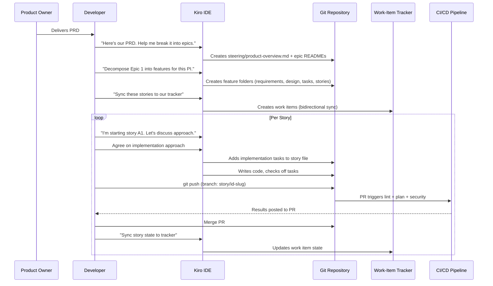

# Spec-Driven Development Process Guide

## Overview

Spec-driven development is a structured workflow where **specifications are the source of truth** for planning, design, and implementation. Instead of maintaining separate documents across Confluence, Jira, and code, everything lives in version-controlled Markdown files that Kiro understands and can sync bidirectionally with your work-item tracker.

### How It Works

You **talk to Kiro** — brainstorm features, discuss architecture, debate tradeoffs. Once you've agreed on the approach, **Kiro creates and maintains all the spec files** (requirements, design, stories, work-item-map.yaml). You don't write these files by hand. You discuss, decide, and approve — Kiro handles file creation, formatting, and tracker synchronization.

### Core Principles

| Principle | What It Means |
|-----------|---------------|
| Conversational planning | Brainstorm with Kiro, then let it formalize the outcome |
| Story files are source of truth | Your tracker is a sync target, not the primary record |
| Kiro manages artifacts | Developers focus on decisions, not file management |
| Structured decomposition | PRD → Epics → Features → Stories → Tasks |
| Traceability | Every story traces to requirements and design sections |
| Deviation tracking | Differences from design are explicitly documented |
| Quality gates baked in | Every story includes validation tasks |
| ADRs as deliverables | Architecture decisions are first-class story outputs |

---

## Process Flow



---

## The Five Phases

### Phase 1: PRD Intake and Epic Extraction

**Input:** Product Requirements Document
**Output:** `steering/product-overview.md` + epic-level README files

Start a conversation with Kiro and share your PRD. Discuss:
- What are the major capability areas (epics)?
- What's the delivery timeline (PIs, sprints)?
- What are the technology constraints?
- What are the non-functional requirements?

Kiro produces:
- A `product-overview.md` steering file (loaded in every session)
- A `technology-guidelines.md` steering file
- Epic-level README files under `.kiro/specs/`

### Phase 2: Feature Decomposition

**Input:** Epics + architectural context
**Output:** Feature folders with requirements.md, design.md, tasks.md, stories

For each epic, discuss with Kiro:
- What are the deliverable features for this increment?
- What's the scope boundary for each feature?
- What are the dependencies between features?
- What architectural decisions need to be made?

Kiro creates a folder per feature:
```
.kiro/specs/<featureId>-<slug>/
├── requirements.md      # Traceability to PRD
├── design.md            # Architectural decisions
├── tasks.md             # Sprint-level checklist
├── work-item-map.yaml   # Index, capacity, deviations
└── stories/             # One file per story
```

### Phase 3: Story Creation and Refinement

**Input:** Feature scope + design decisions
**Output:** Individual story files with acceptance criteria

For each feature, discuss with Kiro:
- How should we decompose this into implementable stories?
- What's the effort estimate per story?
- Who owns each story?
- What are the dependencies between stories?
- What are the acceptance criteria?

Kiro creates story files with:
- YAML front-matter (scheduling, ownership, classification)
- Context, Goal, Scope sections
- Acceptance criteria (Given/When/Then)
- Dependencies documented

### Phase 4: Implementation

**Input:** Story file + conversation about approach
**Output:** Code, infrastructure, ADRs, documentation

For each story:
1. Tell Kiro which story you're picking up
2. **Discuss the implementation approach** — what to build, which patterns to follow, open questions
3. **Kiro writes implementation tasks** — detailed subtasks added to the story file
4. **Kiro executes the tasks** — writes code, checks off boxes, runs validation
5. You review, request adjustments, approve

### Phase 5: Delivery and Sync

**Input:** Completed implementation
**Output:** Merged PR, updated tracker, deployed code

After implementation:
1. Commit with work-item trailer (e.g., `Work-Item: 12345`)
2. Open PR — CI validates quality gates
3. Merge — CD deploys to target environment
4. Sync story state to tracker (Done/Closed)
5. Update tasks.md checklist

---

## Spec Lifecycle in Detail

### Story File Lifecycle

```
trackerId: pending (file created)
    ↓ Kiro syncs to tracker
trackerId: 12345 (file renamed to include ID)
    ↓ Developer starts work
state: Active
    ↓ Implementation tasks added
## Implementation Tasks added to file
    ↓ Tasks executed and checked off
- [x] completed tasks
    ↓ All tasks done, validation passes
state: Done
    ↓ Synced to tracker
Tracker shows: Done/Closed
```

### Iterating on Specs

Specs evolve. Common adjustments during a PI:

- *"Move story A5 to Sprint 2 — it depends on A4"*
- *"Add an acceptance criterion for encryption at rest"*
- *"Split this story — the database part should be separate"*
- *"Change the effort on A4 from 3 to 5"*
- *"We need to add a story for monitoring — didn't account for it"*

Kiro handles all file updates. You never edit YAML front-matter by hand.

### Deviation Tracking

When implementation diverges from the original design (it always does), capture it formally:

```yaml
# In work-item-map.yaml
deviations_from_design:
  - id: DEV-001
    topic: Authentication flow
    design_says: "OAuth2 with PKCE"
    reality: "Basic auth for MVP, OAuth2 in next PI"
    reason: "IdP integration not ready"
    captured_in: docs/decisions/0003-auth-approach.md
```

This keeps the team honest about technical debt and ensures design docs don't silently go stale.

---

## Quality Gates

### Built into Every Story

Every story includes a validation section:

```markdown
### Task N: Validation
- [ ] N.1 Linting passes
- [ ] N.2 Tests pass
- [ ] N.3 Security scan — no high-severity findings
- [ ] N.4 Build succeeds
- [ ] N.5 Acceptance criteria verified
```

### Automated via Hooks

Hooks run automatically on file events:
- **On write** — lint, format, validate
- **On create** — architecture alignment review
- **On save** — documentation generation

### Enforced in CI/CD

GitHub Actions (or your CI system) enforce:
- All quality gates must pass before merge
- Work-item link required on every PR
- Plan output posted as PR comment (for infrastructure)
- Security scanning blocks on findings above threshold

---

## Roles and Responsibilities

| Role | Responsibilities |
|------|-----------------|
| **Product Owner** | Writes PRD, prioritizes features, accepts stories |
| **Developer** | Discusses with Kiro, reviews specs, approves implementations, merges PRs |
| **Kiro** | Creates/maintains all spec artifacts, implements code, syncs with tracker, validates quality |
| **CI/CD** | Enforces quality gates, deploys, validates links |

---

## Anti-Patterns to Avoid

| Anti-Pattern | Why It's Bad | Do This Instead |
|--------------|-------------|-----------------|
| Editing story front-matter by hand | Breaks sync, introduces typos | Tell Kiro what to change |
| Skipping the design discussion | Stories lack context, Kiro guesses wrong | Spend 5 minutes discussing approach before implementation |
| Massive stories (>5 PD) | Too much scope, hard to review | Split into 2-3 day stories |
| Ignoring deviation tracking | Design docs go stale silently | Record deviations in work-item-map.yaml |
| Not using steering files | Kiro loses context between sessions | Keep steering current with project decisions |
| Writing specs without Kiro | Inconsistent format, manual overhead | Let Kiro create and maintain spec files |
