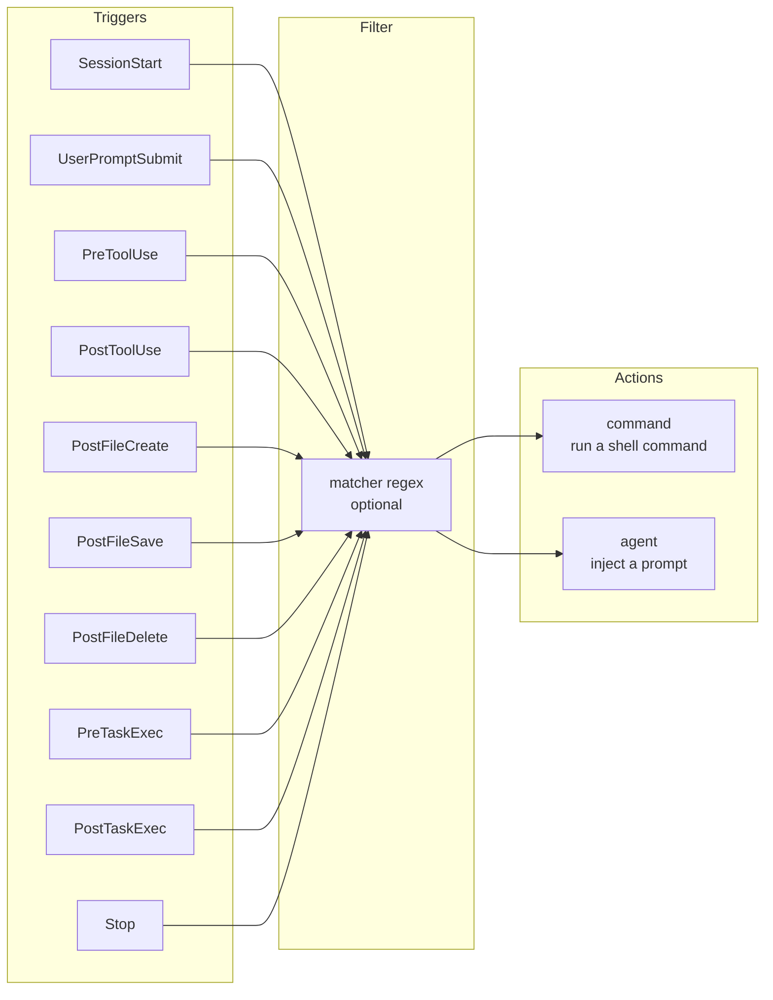

# Hooks Guide

Hooks turn your quality standards into automation. Instead of remembering to run
the linter, validate Terraform, or check that specs stay consistent, you declare
the rule once and Kiro enforces it on every relevant event.

At team scale this is the difference between a methodology that holds and one
that quietly decays. Two developers reviewing each other's pull requests can
self-police. Twenty-five cannot. Hooks plus the CI templates in
[`templates/workflows/`](../templates/workflows/) are what keep the process
honest when nobody is watching.

---

## How Hooks Work



When the trigger fires, Kiro tests the `matcher`. If it matches, or if no
matcher is set, the action runs.

---

## Hook File Format

Each hook file is standalone JSON at `.kiro/hooks/<id>.json`. Any filename
works; use descriptive kebab-case. Hooks activate automatically at session
start, with no registration step.

```json
{
  "version": "v1",
  "hooks": [
    {
      "name": "Lint on Save",
      "description": "Optional. Documentation only.",
      "trigger": "PostFileSave",
      "matcher": "^src/.*\\.py$",
      "timeout": 60,
      "enabled": true,
      "action": {
        "type": "command",
        "command": "ruff check --fix src/"
      }
    }
  ]
}
```

One file can define multiple hooks in the `hooks` array.

### Field Reference

| Field | Required | Description |
|-------|:--------:|-------------|
| `version` | Yes | The literal string `"v1"`. Not semver — `"1.0.0"` is invalid. |
| `hooks` | Yes | Array of hook definitions |
| `hooks[].name` | Yes | Human-readable identifier |
| `hooks[].description` | No | Documentation only |
| `hooks[].trigger` | Yes | PascalCase event name (see below) |
| `hooks[].matcher` | No | Single regex string. Defaults to always-match. |
| `hooks[].action.type` | Yes | `"command"` or `"agent"` |
| `hooks[].action.command` | Conditional | Required when type is `"command"` |
| `hooks[].action.prompt` | Conditional | Required when type is `"agent"` |
| `hooks[].timeout` | No | Seconds for command actions (default 60, `0` disables). Ignored for agent actions. |
| `hooks[].enabled` | No | Set `false` to disable without deleting. Default `true`. |
| `hooks[].confirm` | No | Ask before running. `Stop` command hooks only. |

> **Migrating from IDE 0.x?** The old format used `.kiro.hook` files with
> top-level `when`/`then` keys, camelCase event names, and a `patterns` glob
> array. None of that loads as a v1 hook. Run
> [`check-hook-schema.py`](../templates/hooks/scripts/check-hook-schema.py)
> against your hooks directory to find what needs changing. The IDE also shows
> an upgrade badge on legacy hooks in the Agent Hooks panel.

---

## Triggers

All trigger names are PascalCase.

| Trigger | Fires when | Can block? | Matcher tests |
|---------|-----------|:----------:|---------------|
| `PostFileSave` | The agent saves or modifies a file | No | File path |
| `PostFileCreate` | The agent creates a new file | No | File path |
| `PostFileDelete` | The agent deletes a file | No | File path |
| `PreToolUse` | Before a tool executes | **Yes** | Tool name |
| `PostToolUse` | After a tool executes | No | Tool name |
| `UserPromptSubmit` | A message is sent to the agent | **Yes** | Prompt text |
| `SessionStart` | A new session begins | No | Not evaluated |
| `Stop` | The agent finishes responding | No | Not evaluated |
| `PreTaskExec` | Before a spec task starts | **Yes** | Not evaluated |
| `PostTaskExec` | After a spec task completes | No | Not evaluated |

`PreTaskExec` and `PostTaskExec` are IDE-only.

### Two things that surprise people

**File triggers respond only to changes made by the agent.** Saving a file
yourself in the editor does not fire `PostFileSave`. These hooks govern what
Kiro does, not what you do. If you want checks on your own edits, use a git
pre-commit hook or CI.

**For tool events, the matcher tests the tool name, not the file path.** A
`PostToolUse` hook with `"matcher": "^infra/.*\\.tf$"` will never fire, because
it is comparing that regex against a tool name like `fs_write`. To act on
Terraform files, use `PostFileSave` with a path matcher.

### Matcher patterns

Matchers are regexes, not globs. `src/**/*.ts` does not work.

| Intent | Matcher |
|--------|---------|
| Python files under `src/` | `^src/.*\\.py$` |
| Terraform under `infra/` | `^infra/.*\\.tf$` |
| Several extensions | `\\.(ts\|tsx\|js)$` |
| Spec files | `^\\.kiro/specs/.*\\.(md\|yaml)$` |
| Any dependency manifest | `(requirements.*\\.txt\|package\\.json\|go\\.mod)$` |

For tool events, use canonical names or aliases:

| Matcher | Matches |
|---------|---------|
| `write` or `fs_write` | File write tools |
| `read` or `fs_read` | File read tools |
| `shell` or `execute_bash` | Shell execution |
| `aws` or `use_aws` | AWS CLI tool |
| `*` | All tools, built-in and MCP |
| `@builtin` | Built-in tools only |
| `@mcp` | All MCP tools |
| `@git/status` | One specific tool from the git MCP server |
| `@mcp.*sql.*` | MCP tools whose names contain "sql" |

Prefixes beginning with `@` are matched as regexes.

---

## Actions

### `command`

Runs a shell command from your project root. Deterministic, fast, and it does
not consume model credits.

```json
{ "type": "command", "command": "ruff check --fix src/" }
```

The command receives the hook event as JSON on **STDIN**:

```json
{
  "hook_event_name": "preToolUse",
  "cwd": "/path/to/project",
  "session_id": "abc123-def456",
  "tool_name": "fs_write",
  "tool_input": { "path": "src/app.py", "text": "..." }
}
```

Note that `hook_event_name` in the payload uses camelCase even though the
`trigger` you configure is PascalCase. `PostToolUse` events also carry a
`tool_response` field. For `UserPromptSubmit`, the prompt is additionally
available in the `USER_PROMPT` environment variable.

There is no `{{filePath}}` style templating. Read STDIN if you need the path.

**Exit codes matter:**

| Exit code | Effect |
|-----------|--------|
| `0` | Success. STDOUT is added to the agent's context for `SessionStart` and `UserPromptSubmit`, ignored otherwise. |
| `2` | **Blocks** the operation on `PreToolUse`, `UserPromptSubmit`, and `PreTaskExec`. STDERR goes to the agent. |
| Anything else | Treated as a failure. STDERR is shown to you as a warning and execution proceeds. |

Exit code 2 is what makes real guard rails possible. Any other non-zero code is
a broken hook, not a block.

A `Stop` hook can also keep the agent working by printing a decision on STDOUT:

```json
{ "decision": "block", "reason": "Tests are failing. Fix them before stopping." }
```

The `reason` is sent back as a new user message, which lets you build a
verify-then-continue loop.

### `agent`

Injects a prompt into the conversation. Use it for judgment calls that a script
cannot make.

```json
{ "type": "agent", "prompt": "Review this file against our coding standards." }
```

On `UserPromptSubmit`, the hook prompt is appended to the user's prompt and the
combined text is sent.

Agent actions start a new agent loop, so they consume credits and are slower
than commands. Reach for `command` first.

### Choosing between them

| Use `command` when | Use `agent` when |
|--------------------|------------------|
| The check is deterministic | The check needs judgment |
| A tool already exists (ruff, terraform, checkov) | You are enforcing a convention no linter encodes |
| You want to block on failure | You want advice, not a gate |
| Speed and cost matter | Correctness depends on surrounding context |

---

## Recommended Hooks

The repository ships ten ready-to-use templates in
[`templates/hooks/`](../templates/hooks/). Copy one to `.kiro/hooks/<id>.json`
and edit the matcher and command for your stack.

| Template | Trigger | What it does |
|----------|---------|--------------|
| `terraform-validate` | `PostFileSave` | `terraform fmt` and `validate` on infra changes |
| `design-review` | `PostFileCreate` | Reviews new files against your architecture |
| `lint-on-save` | `PostFileSave` | Runs your linter on source changes |
| `test-after-task` | `PostTaskExec` | Runs the suite when a spec task completes |
| `security-scan` | `PostFileSave` | `checkov` against infrastructure code |
| `spec-consistency` | `PostFileSave` | Validates spec integrity (see below) |
| `secret-guard` | `PreToolUse` | **Blocks** writes containing credentials |
| `api-contract-check` | `PostFileSave` | Route changes against API conventions |
| `dependency-audit` | `PostFileSave` | Flags unpinned or risky dependencies |
| `session-context` | `SessionStart` | Injects branch and in-flight stories |

Two of these deserve a closer look because they carry most of the weight.

### `spec-consistency` — the one that keeps specs honest

Specs drift. A story gets deleted but stays in `work-item-map.yaml`. A task is
checked off for a story file nobody wrote. A `dependsOn` points at a ref that
was renamed. Each is individually trivial and collectively fatal to
traceability.

[`check-spec-integrity.py`](../templates/hooks/scripts/check-spec-integrity.py)
catches all of it:

| Code | Check |
|------|-------|
| E1 | Every story in `work-item-map.yaml` exists on disk |
| E2 | Every story file on disk is listed in the map |
| E3 | Every story ref in `tasks.md` resolves to a story file |
| E4 | Every `dependsOn` ref resolves to a real story |
| E5 | A story marked Done has no unchecked implementation tasks |
| E6 | Story refs are globally unique across all features |
| E7 | No self-dependencies and no dependency cycles |
| E8 | Every story file carries a `ref` in its front matter |
| W1 | Capacity totals match the sum of story effort |
| W2 | Stories marked Done have been synced to the tracker |
| W3 | A story with every task checked has been moved to Done |

It is stdlib-only Python with no YAML dependency, so the same script runs as a
hook and as a CI gate:

```bash
python3 .kiro/hooks/scripts/check-spec-integrity.py            # warnings allowed
python3 .kiro/hooks/scripts/check-spec-integrity.py --strict   # warnings fail
```

Wire it as a hook while you edit specs, and as a required check via
[`spec-integrity.template.yml`](../templates/workflows/) so drift cannot merge.

### `secret-guard` — a real blocking hook

This is the pattern to copy when you want a hard gate rather than advice.

```json
{
  "version": "v1",
  "hooks": [
    {
      "name": "Secret Guard",
      "trigger": "PreToolUse",
      "matcher": "write|replace|append",
      "timeout": 15,
      "action": {
        "type": "command",
        "command": "python3 .kiro/hooks/scripts/secret-guard.py"
      }
    }
  ]
}
```

The matcher is `write|replace|append` rather than just `write` so the guard also
fires for editing tools (`str_replace`, `fs_append`) that mutate files without
"write" in their name. A guard that only watches one of three doors is not a guard.

[`secret-guard.py`](../templates/hooks/scripts/secret-guard.py) reads the event
from STDIN, scans `tool_input` for credential-shaped strings, and exits 2 with
an explanation if it finds one. The agent receives the STDERR text and can
correct course. It allows through anything that looks like an obvious
placeholder, so documentation examples do not trip it.

Note that it walks the raw string values in `tool_input` rather than scanning a
serialized copy. Serializing escapes embedded quotes, which breaks patterns that
expect a quote right after an assignment. That detail is easy to get wrong.

---

## Design Patterns

### Guard rail — block before damage

`PreToolUse` with a command action that exits 2. The only pattern that can
actually prevent something.

```json
{
  "trigger": "PreToolUse",
  "matcher": "write|replace|append",
  "action": { "type": "command", "command": "python3 .kiro/hooks/scripts/secret-guard.py" }
}
```

Keep these fast and keep them precise. A guard rail with false positives gets
disabled within a week.

### Post-write validation — catch it immediately

`PostFileSave` with a command action. The tightest feedback loop available:
Kiro writes the file, the check runs, failures come straight back.

```json
{
  "trigger": "PostFileSave",
  "matcher": "^infra/.*\\.tf$",
  "timeout": 180,
  "action": { "type": "command", "command": "terraform fmt -recursive infra/ && terraform -chdir=infra/terraform validate" }
}
```

### Contextual reminder — temporary constraints

`UserPromptSubmit` with an agent action, appended to every message. Ideal for
constraints with an expiry date. Delete the hook when the freeze lifts.

```json
{
  "trigger": "UserPromptSubmit",
  "action": { "type": "agent", "prompt": "We are in code freeze until Friday. Bug fixes only, no new features." }
}
```

### Session priming — start with the right context

`SessionStart` with a command action whose STDOUT is added to context. Cheap
way to tell Kiro which branch you are on and which stories are in flight.

```json
{
  "trigger": "SessionStart",
  "action": { "type": "command", "command": "python3 .kiro/hooks/scripts/session-context.py" }
}
```

### Verify-then-continue — close the loop

`Stop` with a command action that returns a block decision when the work is not
actually finished.

```json
{
  "trigger": "Stop",
  "action": { "type": "command", "command": "pytest -q || echo '{\"decision\":\"block\",\"reason\":\"Tests are failing. Fix them before finishing.\"}'" }
}
```

### Task gate — enforce readiness

`PreTaskExec` with a command action that exits 2 when prerequisites are unmet.
Useful for stopping work on a story whose dependencies are not yet Done.

---

## Practices

1. **Start with three hooks.** Lint, spec-consistency, and one guard rail. Add
   more only when you notice a manual step repeating.
2. **Prefer `command` over `agent`.** Cheaper, faster, deterministic, and it
   can block. Save agent actions for genuine judgment calls.
3. **One check per hook.** A prompt with a ten-point audit produces vague
   results. Split it.
4. **Never let an unconfigured hook pass silently.** A placeholder that exits 0
   gives false confidence. The templates here exit 1 with instructions instead.
5. **Put real logic in a script, not in the JSON string.** Escaping shell and
   Python inside JSON is a reliable source of broken hooks. Keep the config
   readable and put the work in `.kiro/hooks/scripts/`.
6. **Set a `timeout` on anything slow.** The default is 60 seconds. Terraform
   and test suites need more; guard rails should need far less.
7. **Validate before committing.** Run
   [`check-hook-schema.py`](../templates/hooks/scripts/check-hook-schema.py) so
   a malformed hook does not reach the team's branch.
8. **Commit hooks to the repo.** Hooks in `.kiro/hooks/` are shared standards.
   Use `enabled: false` rather than deleting when you need to pause one, so the
   intent stays visible.

---

## Next

| Document | Why |
|----------|-----|
| [01 — Process Guide](01-process-guide.md) | Where hooks sit among the quality gates |
| [03 — Steering Guide](03-steering-guide.md) | Hook prompts reference steering; keep them aligned |
| [templates/workflows/README.md](../templates/workflows/README.md) | The CI half of enforcement — hooks vs CI, and which gate belongs where |
