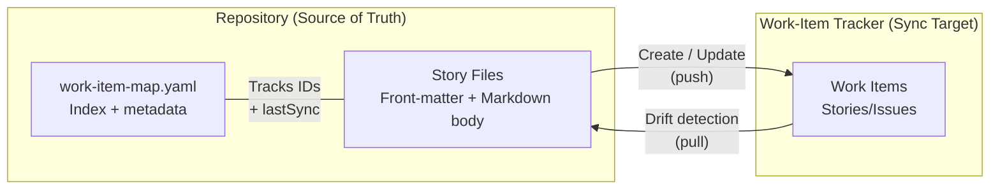

# Work-Item Sync Guide

## Overview

Kiro can synchronize story files bidirectionally with your work-item tracker (Azure DevOps, GitHub Issues, Jira, etc.). Story files in your repository are the **source of truth** for content; the tracker is the sync target for visibility and status tracking.

---

## Architecture



### Sync Principles

1. **Story files are source of truth** — All content (title, description, acceptance criteria, effort) is authored in story files
2. **Tracker is for visibility** — Team members, stakeholders, and dashboards consume the tracker
3. **Explicit approval required** — Kiro never writes to the tracker without your confirmation
4. **Minimal patches** — Only changed fields are updated (not full overwrites)
5. **Drift detection** — Kiro can detect when someone edits the tracker directly and alert you

---

## Setup

### Step 1: Configure MCP Server

Add your tracker's MCP server to `.kiro/settings/mcp.json`:

**Azure DevOps:**
```json
{
  "mcpServers": {
    "azureDevOps": {
      "command": "npx",
      "args": ["-y", "@tiberriver256/mcp-server-azure-devops"],
      "env": {
        "AZURE_DEVOPS_ORG_URL": "https://dev.azure.com/YOUR-ORG",
        "AZURE_DEVOPS_AUTH_METHOD": "pat",
        "AZURE_DEVOPS_PAT": "${AZURE_DEVOPS_PAT}",
        "AZURE_DEVOPS_DEFAULT_PROJECT": "Your Project"
      },
      "autoApprove": ["get_work_item", "search_work_items", "list_work_items"]
    }
  }
}
```

**GitHub:**
```json
{
  "mcpServers": {
    "github": {
      "command": "npx",
      "args": ["-y", "@modelcontextprotocol/server-github"],
      "env": {
        "GITHUB_PERSONAL_ACCESS_TOKEN": "${GITHUB_TOKEN}"
      },
      "autoApprove": ["get_issue", "list_issues"]
    }
  }
}
```

> **Auto-approve reads, never writes.** Sync principle 3 says Kiro never writes to the
> tracker without your confirmation — so `create_*` and `update_*` tools must stay out
> of `autoApprove`. Auto-approving reads keeps drift checks fast; leaving writes on
> manual approval is what makes the "show me the payload, then I approve" flow real.

### Step 2: Create Sync Playbook Steering File

Create `.kiro/steering/work-item-sync-playbook.md` with `inclusion: manual`:

```yaml
---
inclusion: manual
---
```

This file documents your sync protocol — field mappings, aliases, conventions. See the templates for a complete example.

### Step 3: Define Field Mappings

Document how story front-matter maps to tracker fields:

| Front-matter | Azure DevOps | GitHub Issues |
|-------------|-------------|---------------|
| `title` | System.Title | Issue title |
| `state` | System.State | open/closed + label |
| `owner` | System.AssignedTo | Assignee |
| `effort` | Scheduling.Effort | Label (effort:3) |
| `sprint` | System.IterationPath | Milestone |
| `tags` | System.Tags | Labels |
| `priority` | Common.Priority | Label (priority:2) |

---

## Sync Flows

### Create (Push New Stories)

When story files have `trackerId: pending`:

1. Attach the sync playbook: `#work-item-sync-playbook`
2. Tell Kiro: *"Create all pending stories in the tracker"*
3. Kiro shows you the full payload for each story
4. You approve
5. Kiro calls the tracker API to create work items
6. Kiro updates story files with returned IDs
7. Kiro renames files to include the tracker ID
8. Kiro updates work-item-map.yaml

### Update (Push Changes)

When you've edited story content and want to sync:

1. Attach: `#work-item-sync-playbook`
2. Tell Kiro: *"Sync story A3 to the tracker"* (or "Sync all stories in this feature")
3. Kiro reads current tracker state
4. Kiro computes the minimal diff (only fields that changed)
5. Kiro shows: field | tracker value | story file value
6. You approve
7. Kiro applies the minimal patch
8. Kiro updates `lastSync` timestamp

### Pull (Detect Drift)

When someone may have edited the tracker directly:

1. Attach: `#work-item-sync-playbook`
2. Tell Kiro: *"Check for drift in this feature's stories"*
3. Kiro reads all tracker work items for stories in scope
4. Kiro compares tracker state vs story files (using `lastSync` as baseline)
5. For each drifted field, Kiro shows the difference
6. You choose per field: accept tracker change | overwrite tracker | skip
7. Kiro applies your choices

---

## Work-Item Map (work-item-map.yaml)

The map file is an index that ties everything together:

```yaml
feature:
  id: 101
  title: Authentication & Authorization
  tracker_url: https://dev.azure.com/.../101
  priority: 2
  effort: 20

scheduling:
  pi: PI-1
  sprints: [S1, S2, S3]

capacity:
  alice: { s1: 8, s2: 6, s3: 6, total: 20 }
  total: { s1: 8, s2: 6, s3: 6, total: 20 }

stories:
  A1: { trackerId: 12345, file: stories/A1-12345-oauth2-provider.md }
  A2: { trackerId: 12346, file: stories/A2-12346-rbac-middleware.md }
  A3: { trackerId: pending, file: stories/A3-pending-tenant-isolation.md }

deviations_from_design:
  - id: DEV-001
    topic: Auth flow
    design_says: "OAuth2 + PKCE"
    reality: "Basic auth for MVP"
    reason: "IdP integration timeline"
    captured_in: docs/decisions/0003-auth-mvp.md

deferred_to_next_pi:
  - MFA support
  - SSO federation with customer IdPs

retired: []

lastSync: 2025-03-15T10:30:00Z
```

### What the Map Tracks

| Section | Purpose |
|---------|---------|
| `feature` | Parent feature metadata and link |
| `scheduling` | PI and sprint assignments |
| `capacity` | Person-days per person per sprint |
| `stories` | Index of ref → tracker ID → file path |
| `deviations_from_design` | Where implementation diverges from design |
| `deferred_to_next_pi` | Explicitly descoped items |
| `retired` | Stories that were removed (not deleted) |
| `lastSync` | When the map was last synchronized |

---

## Aliases and Conventions

### Owner Aliases

Define short names for team members in your sync playbook:

```markdown
| Alias | Display Name | Tracker Identity |
|-------|-------------|-----------------|
| alice | Alice Smith | alice@example.com |
| bob | Bob Jones | bob@example.com |
```

Story files use the alias: `owner: alice`
Sync resolves to the full identity when writing to the tracker.

### Sprint Aliases

```markdown
| Alias | Tracker Iteration |
|-------|------------------|
| S1 | Project\PI-1\Sprint 1 |
| S2 | Project\PI-1\Sprint 2 |
| S3 | Project\PI-1\Sprint 3 |
```

### State Mapping

```markdown
| Story State | Azure DevOps | GitHub Issues |
|-------------|-------------|---------------|
| New | New | open + label:new |
| Active | Active | open + label:in-progress |
| Done | Done | closed |
| Removed | Removed | closed + label:wontfix |
```

---

## Body → Tracker Field Mapping

The Markdown body of a story file splits across tracker fields:

### Azure DevOps

- **Everything above `## Acceptance Criteria`** → `System.Description` (HTML)
- **`## Acceptance Criteria` section** → `Microsoft.VSTS.Common.AcceptanceCriteria` (HTML)

Markdown is converted to HTML before sending:
| Markdown | HTML |
|----------|------|
| `## Heading` | `<h3>Heading</h3>` |
| Paragraph | `<p>Paragraph</p>` |
| `- item` | `<ul><li>item</li></ul>` |
| `**bold**` | `<strong>bold</strong>` |
| `Given/When/Then` | `<li><strong>Given</strong> X...</li>` |

### GitHub Issues

- **Entire body** → Issue body (Markdown, no conversion needed)
- **Acceptance criteria** → Rendered as a task list (`- [ ]` checkboxes)

---

## Best Practices

1. **Sync at natural boundaries** — After completing a story, after sprint planning, after retrospective
2. **Don't fight tracker normalization** — Tags get title-cased, descriptions get reformatted. Accept it.
3. **Use lastSync for conflict resolution** — If both sides changed since lastSync, you decide which wins
4. **Batch reads, individual writes** — Read all stories in parallel, but write one at a time for safety
5. **State transitions are human-driven** — Kiro won't move a story to Done without you saying so
6. **Keep the map current** — After every sync operation, update work-item-map.yaml
