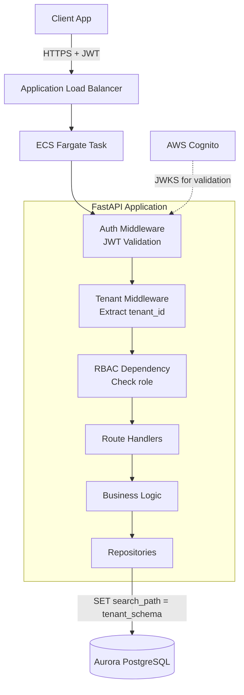

# Design — Authentication & Authorization (Feature 101)

## Summary

PI 1 delivers the core auth stack: Cognito for identity, JWT middleware for validation, RBAC for permissions, and tenant isolation for data boundaries. Social login, MFA, and customer IdP federation are deferred to PI 2.

## Architectural Decisions

### DEC-001 — AWS Cognito as Identity Provider

- **Context:** Need managed authentication that scales to 100+ tenants without operational overhead.
- **Decision:** Use AWS Cognito User Pools with custom attributes for tenant_id and role.
- **Alternatives considered:**
  - Auth0 — more features but vendor lock-in outside AWS, additional cost
  - Self-hosted Keycloak — operational burden, HA complexity
  - IAM Identity Center — designed for workforce, not customer-facing apps
- **Consequences:** Tied to AWS for identity. Cognito has some limitations (custom UI, advanced flows). Acceptable for MVP.
- **Rollback path:** Abstract behind an interface; swap IdP in PI 3 if needed.

### DEC-002 — Schema-per-tenant Database Isolation

- **Context:** Need strong tenant data isolation that's auditable and prevents accidental cross-tenant access.
- **Decision:** Use PostgreSQL schemas — one schema per tenant. Tenant context set at connection level via `SET search_path`.
- **Alternatives considered:**
  - Row-level security (RLS) — simpler infra but harder to audit, risk of policy bugs
  - Database-per-tenant — strongest isolation but expensive at scale, complex migrations
  - Table prefix — fragile, no schema-level permissions
- **Consequences:** Need schema creation during tenant onboarding. Migrations run per-schema. Connection pooling more complex.
- **Rollback path:** Can migrate to RLS by removing schemas and adding tenant_id column + policies.

### DEC-003 — Middleware-based RBAC

- **Context:** Need to enforce permissions consistently without scattering auth checks across every endpoint.
- **Decision:** FastAPI dependency injection with a `require_role()` dependency that reads JWT claims and enforces minimum role level.
- **Alternatives considered:**
  - Decorator-based (@require_admin) — less composable
  - Policy engine (OPA/Cedar) — overkill for 4 roles at this stage
  - Route-level config — error-prone, hard to audit
- **Consequences:** Simple, testable, auditable. Will need to evolve to policy engine when permissions become more granular (PI 3+).
- **Rollback path:** Add OPA/Cedar later; middleware becomes a thin adapter.

## Component Diagram

## Sequencing

| Sprint | Stories | Rationale |
|--------|---------|-----------|
| S1 | A1 (Cognito Terraform) | Infrastructure must exist before app code |
| S1 | A2 (JWT Middleware) | Can develop against Cognito once pool exists |
| S2 | A3 (RBAC) | Builds on JWT middleware |
| S2 | A4 (Tenant Isolation) | Builds on JWT middleware + database |

## Open Questions / Risks

1. **Cognito token size** — Custom attributes increase JWT size. Monitor for ALB header limits (16KB).
2. **Schema migration strategy** — Need a tool/script to apply Alembic migrations across all tenant schemas. Design in A4.
3. **Connection pooling** — Schema-per-tenant means `SET search_path` per request. Verify PgBouncer compatibility or use application-level pooling.
