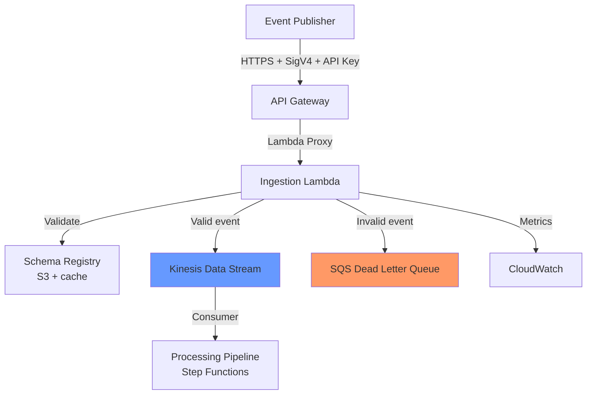

# Design — REST API Ingestion (Feature 101)

## Summary

PI 1 delivers synchronous event ingestion via API Gateway → Lambda → Kinesis. Schema validation happens in the Lambda handler before events reach the processing pipeline. Invalid events are routed to SQS DLQ with full diagnostic metadata.

## Architectural Decisions

### DEC-001 — API Gateway + Lambda over ALB + ECS

- **Context:** Need an HTTP endpoint for event ingestion with < 100ms response time.
- **Decision:** API Gateway REST API with Lambda proxy integration.
- **Alternatives considered:**
  - ALB + ECS Fargate — persistent compute, more expensive at low/variable traffic
  - API Gateway HTTP API — cheaper but lacks API key plans and request validation
  - AppSync — GraphQL overhead unnecessary for simple event ingestion
- **Consequences:** Cold starts possible (mitigated with provisioned concurrency in prod). Pay-per-request pricing ideal for variable traffic.
- **Rollback path:** Move to HTTP API if cost becomes concern; move to ECS if sustained high throughput.
- **Authentication note (DEV-002):** the method uses `authorization = "AWS_IAM"` (SigV4); the API key is metering only, not identity. See `docs/THREAT-MODEL.md` E2-T01/E2-T02.

### DEC-002 — Kinesis for Event Durability (not SQS)

- **Context:** Events must be persisted before acknowledgment. Need ordering and replay capability.
- **Decision:** Write validated events to Kinesis Data Streams before returning 202 to the publisher.
- **Alternatives considered:**
  - SQS — simpler but no ordering, no replay, 256KB message limit
  - EventBridge — good for routing but not designed as durable event store
  - DynamoDB Streams — requires writing to DDB first, adds latency
- **Consequences:** Kinesis has per-shard costs. Using on-demand mode eliminates capacity planning. 24-hour default retention provides replay window.
- **Rollback path:** Replace with SQS if ordering proves unnecessary and cost sensitivity increases.

### DEC-003 — Validate-then-Persist Pattern

- **Context:** Should we validate before or after persisting?
- **Decision:** Validate in the ingestion Lambda BEFORE writing to Kinesis. Invalid events go to DLQ immediately.
- **Alternatives considered:**
  - Persist-then-validate — guarantees no loss but DLQ processing is more complex
  - Validate at consumer — spreads validation logic, harder to debug
- **Consequences:** Invalid events never reach Kinesis (cleaner stream). Publisher gets immediate feedback on schema violations. Slight latency increase (validation adds ~10ms).
- **Rollback path:** Move validation to consumer if ingestion latency becomes critical.

## Component Diagram

## Sequencing

| Sprint | Stories | Rationale |
|--------|---------|-----------|
| S1 | E1 (API Gateway + Lambda) | HTTP endpoint must exist first |
| S1 | E4 (Terraform module) | Infrastructure before app code |
| S2 | E2 (Schema validation + DLQ) | Needs Lambda and infrastructure |
| S2 | E3 (Kinesis persistence + correlation) | Final wiring, end-to-end flow |

## Open Questions / Risks

1. **Cold start mitigation** — Provisioned concurrency adds cost (~$15/month per instance). Defer to prod; accept cold starts in dev.
2. **Schema storage** — Using S3 bucket for JSON Schema files. May migrate to EventBridge Schema Registry in PI 2 for discoverability.
3. **Payload size** — API Gateway limit is 10MB. Kinesis record limit is 1MB. Need to document max event size as 1MB.
