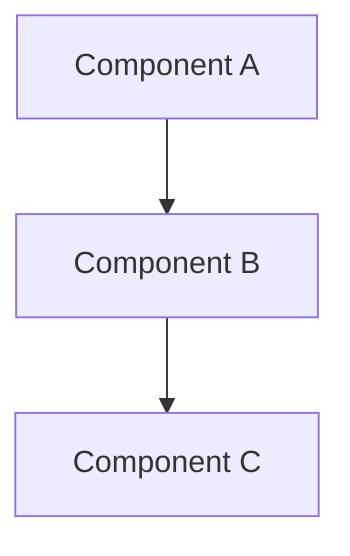

# Design — [Feature Title] (Feature [ID])

## Summary

[What this PI delivers vs the full product vision. One paragraph.]

## Architectural Decisions

### DEC-001 — [Decision Title]

- **Context:** [Why this decision is needed]
- **Decision:** [What we chose]
- **Alternatives considered:**
  - [Option A] — [rejected because]
  - [Option B] — [rejected because]
- **Consequences:** [Impact and tradeoffs accepted]
- **Rollback path:** [How to reverse if needed]

### DEC-002 — [Decision Title]

- **Context:** [Why]
- **Decision:** [What]
- **Alternatives considered:** [What else]
- **Consequences:** [Impact]
- **Rollback path:** [Reversal plan]

## Component Diagram

## Sequencing

| Sprint | Stories | Rationale |
|--------|---------|-----------|
| S1 | [refs] | [Why these first] |
| S2 | [refs] | [Why these second] |

## Open Questions / Risks

1. [Question or risk with mitigation plan]
2. [Question or risk with mitigation plan]
